# MAST Discovery Engine — Current Build vs. Proposed Rebuild: Comparative Architecture Review

> **Status**: Pre-Implementation Comparative Review (Read-Only Audit)  
> **Scope**: Evidence-backed comparison of the current production codebase (`HEAD 785bc3a`) against the proposed rebuild (`docs/discovery-engine-rebuild-blueprint.md` v3), including critical corrections where direct code inspection proved existing components are already more capable than previously assumed.  
> **Core Mandate**: *"We deliver businesses that genuinely need the services the user offers."*

---

## 1. Executive Summary

### 1.1 High-Level Verdict: Targeted Structural & Contract Repairs, Not a Ground-Up Rewrite
A line-by-line audit of the current repository reveals that **MAST's core Engine 2.0 and Node orchestration architecture is already 80–85% built for high-speed, high-quality discovery, but is currently bottlenecked and partially blinded by six specific integration defects across the Node $\leftrightarrow$ Python boundary.**

Calling the required work a "complete architectural replacement" would be inaccurate. Specifically, direct code inspection proves that the current codebase **already** implements:
1. **Real-Time Candidate Streaming**: [`mast-lead-engine/service.py`](file:///c:/bebo/graphic/mast-os-main/mast-os-main/mast-lead-engine/service.py#L1368-L1439) (`discovery_only=True`) and [`src/scraperBridge/pythonBridge.ts:runEngineQuery()`](file:///c:/bebo/graphic/mast-os-main/mast-os-main/src/scraperBridge/pythonBridge.ts#L1849-L2128) **already** stream candidates line-by-line over `stdout` as an `AsyncGenerator<EngineLead>`.
2. **In-Memory Homepage HTML Reuse**: [`WebsiteWorker.process()`](file:///c:/bebo/graphic/mast-os-main/mast-os-main/mast-lead-engine/workers/website_worker.py#L483) **already** attaches `homepage_html=html` to `WebsiteIntel`, and [`ContactWorker.process()`](file:///c:/bebo/graphic/mast-os-main/mast-os-main/mast-lead-engine/workers/contact_worker.py#L563-L604) **already** consumes `item.homepage_html` as a `free_page` (`0.0s`, zero network fetches) before fetching `/contact`.
3. **Multiplexed Persistent Enrichment Daemon & In-Memory Scoring**: [`service.py:_enrich_daemon_cli()`](file:///c:/bebo/graphic/mast-os-main/mast-os-main/mast-lead-engine/service.py#L2451-L2524) (`asyncio.Semaphore(16)`) and [`PersistentEnrichmentBridge`](file:///c:/bebo/graphic/mast-os-main/mast-os-main/src/scraperBridge/pythonBridge.ts#L903-L942) **already** exist, and [`engine_enrichment_bridge.py:enrich_business_with_engine_v2()`](file:///c:/bebo/graphic/mast-os-main/mast-os-main/mast-lead-engine/engine_enrichment_bridge.py#L146-L148) **already** runs `ScoringWorker().process(enriched)` for all 12 professions.
4. **Pre-Click Known-Place & Closed-Business Skipping**: [`mast-lead-engine/scraper/maps_scraper.py`](file:///c:/bebo/graphic/mast-os-main/mast-os-main/mast-lead-engine/scraper/maps_scraper.py#L2870-L2897) **already** skips `known_place_ids` and `card_signals.closed` before clicking a card, and [`_evaluate_panel_identity()`](file:///c:/bebo/graphic/mast-os-main/mast-os-main/mast-lead-engine/scraper/maps_scraper.py#L1112-L1135) **already** supports verifying panel transitions when clicking from one open detail panel directly to the next card.

### 1.2 Why Current Live Discovery Is Slow (`240s–600s+`) and Misses Quality Signals Today
Despite those strong foundations, six verified integration defects currently serialize execution, waste HTTP/process budgets, and drop quality signals:
1. **Sequential Consumer Blocking + Self-Induced Re-Enrichment (`src/jobs/discoveryPlanJob.ts` lines 361–560)**:
   - `runOneAreaAttempt()` awaits `ensureEnriched(businessId)` **synchronously inside its `for await (const lead of provider.search(...))` loop**, pausing consumption of the Python stream for `4s–15s` on every candidate.
   - Worse, line 540 calls `await enqueueBusinessProcessing(businessId, "enrich")` **unconditionally before `ensureEnriched()`**. In [`src/jobs/businessProcessingJob.ts:claimOrCreateProcessingTask()`](file:///c:/bebo/graphic/mast-os-main/mast-os-main/src/jobs/businessProcessingJob.ts#L108-L116), if a business was **already enriched and `"completed"`**, `enqueueBusinessProcessing()` **reopens the `"completed"` row back to `"queued"`**, forcing `ensureEnriched()` to re-crawl and re-score already-enriched pool businesses from scratch—and racing against the background `business.enrich` worker (`1,000ms` polling sleep loop at line 329).
2. **Incomplete Enrichment Input Causes Unnecessary Subpage Crawls & Redundant Cold `service.py score` Subprocesses (`src/jobs/businessProcessingJob.ts` lines 402 & 480)**:
   - Line 402 calls `runEngineEnrich({ website: business.website })` with **only** `{ website }`, omitting `phone` (already extracted from Google Maps!), `name`, `category`, `rating`, `review_count`, `has_photos`, and `required_channels`.
   - Because `WebsiteIntel.known_channels` is left empty (`()`) and `ContactWorker._required_channels` is `None`, [`ContactWorker._is_requirement_unsatisfied()`](file:///c:/bebo/graphic/mast-os-main/mast-os-main/mast-lead-engine/workers/contact_worker.py#L397-L405) sees `"phone" not in known` and crawls up to 3 extra subpages (`/contact`, `/about`, etc.) looking for a phone number that Google Maps **already supplied**!
   - And because `runEngineEnrich` lacked the business's rating/reviews/name, `businessProcessingJob.ts` line 480 discards `site.profession_scores` and calls [`computeAndStoreOpportunityScores(businessId)`](file:///c:/bebo/graphic/mast-os-main/mast-os-main/src/scoring/storeOpportunityScores.ts#L20), spawning a **second cold `python service.py score` subprocess** (`1.5s–3.5s` overhead) for every single business.
3. **`review_count` vs. `reviews` Contract Mismatch Disables `minReviewCount: 20` and Writes `reviews_count = 0`**:
   - [`service.py:_candidate_dict()`](file:///c:/bebo/graphic/mast-os-main/mast-os-main/mast-lead-engine/service.py#L644) emits `"review_count"`, while [`discoveryPlanJob.ts`](file:///c:/bebo/graphic/mast-os-main/mast-os-main/src/jobs/discoveryPlanJob.ts#L485) passes `reviews: lead.reviews` (`undefined`) to `evaluateLeadQuality()` and [`deliverLead.ts`](file:///c:/bebo/graphic/mast-os-main/mast-os-main/src/scraperBridge/deliverLead.ts#L272) writes `reviews_count: lead.reviews ?? 0`.
4. **Dropped Service-Need Signals Between `WebsiteWorker`, `ScoringWorker`, and `businesses`**:
   - `BusinessCandidate` drops `has_photos` from `RawPlace` ([`google_maps_provider.py`](file:///c:/bebo/graphic/mast-os-main/mast-os-main/mast-lead-engine/providers/google_maps_provider.py#L499)).
   - `WebsiteWorker` fetches the homepage HTML (`html`), but does not run the existing pure helpers in [`enrichment/site_crawler.py`](file:///c:/bebo/graphic/mast-os-main/mast-os-main/mast-lead-engine/enrichment/site_crawler.py) (`_detect_seo_signals`, `_detect_blog_signal`, `detect_tech_stack`, `_detect_growth_signals`).
   - [`ScoringWorker.process()`](file:///c:/bebo/graphic/mast-os-main/mast-os-main/mast-lead-engine/workers/scoring_worker.py#L314-L332) hardcodes `"has_photos": False`, `"load_time_ms": None`, omits `"seo"` and `"blog"`, and ignores `contact_intel.instagram_url`.
5. **No Profession Service-Need Gate & Missing `leads.opportunity_score` in Live Discovery**:
   - [`discoveryPlanJob.ts`](file:///c:/bebo/graphic/mast-os-main/mast-os-main/src/jobs/discoveryPlanJob.ts#L601-L609) delivers any candidate that passes rating + contact channel filters without checking whether the business has any observable service need for `payload.request.professionSlug`, and omits `opportunityScore` when calling `deliverLead()`, leaving `leads.opportunity_score = null`.
6. **Unconditional `_return_to_results()` After Every Maps Card (`maps_scraper.py` line 3256)**:
   - Even when desktop Google Maps keeps `div[role='feed']` mounted alongside the detail drawer, the `finally` block runs `_return_to_results()` (`Escape` + back button / `history.back()`) on every card.

---

## 2. Current Architecture and Actual Behavior

### 2.1 End-to-End Execution Trace of the Current Production Build

```mermaid
flowchart TD
    subgraph UI_API ["1. UI & API Gateway (discoverRequest.ts -> discover.ts)"]
        A1["buildDiscoverRequest()<br/>quantity, region, niche, channels, method, mode"] --> A2["POST /v1/discover (discover.ts)<br/>• Validate auth & schema<br/>• getPlan(profile.plan) -> PlanConfig<br/>• Check isDiscoveryModeAllowed, regionalSearch, allowedChannels<br/>• Check/clamp quota via try_increment_lead_usage(p_count: 0)<br/>• Resolve professionSlug = professionSlugForLabel(focusArea) (null if unset)"]
        A2 -- "mode == live" --> A3["enqueueDiscoveryPlan() (planner.ts)<br/>Upsert discovery_plans + send pg-boss discovery.plan"]
    end

    subgraph Planner_Worker ["2. Plan Materialization & Task Dispatch (planner.ts -> discoveryPlanJob.ts)"]
        A3 --> B1["handleDiscoveryPlanJob()<br/>materializeDiscoveryPlan():<br/>• Expand region -> countries -> majorCities<br/>• Rank by discovery_location_stats yield<br/>• Scale priority into plan.priorityBand [base..ceiling]<br/>• Compute candidate_budget = max(20, quantity * 4)<br/>• dispatchQueuedDiscoveryTasks() respecting getPlanConcurrency(planTierId)"]
        B1 --> B2["handleDiscoveryTask()<br/>• Check hasCuratedAreas(city) (skips Overpass street_inventory when true)<br/>• Launch runAreaWorkerPool() (up to 2 concurrent scouts on 2 browser slots)"]
    end

    subgraph Scout_Loop ["3. Per-Area Scout & Sequential Consumer Loop (runOneAreaAttempt)"]
        B2 --> C1["Spawn python service.py query (discovery_only=True)<br/>• MapsScraper clicks cards, probes website if required, yields RawPlace<br/>• Runs _return_to_results() in finally after EVERY card<br/>• _candidate_dict() emits review_count (NOT reviews) and drops has_photos"]
        C1 -- "AsyncGenerator<EngineLead> (stdout JSONL)" --> C2["SEQUENTIAL for await (const lead of provider.search)<br/>• validateDiscoveryCandidate(lead)<br/>• evaluateLeadQuality({ rating, reviews: lead.reviews [UNDEFINED!] })<br/>• evaluateEarlyChannelPrune(lead, channels)"]
        C2 --> C3["upsertBusinessFromEngineLead(lead)<br/>• Matches fingerprints in businesses<br/>• BUG: inserts reviews_count = 0, has_photos = undefined"]
        C3 --> C4["await enqueueBusinessProcessing(businessId, 'enrich')<br/>• BUG: Reopens even 'completed' tasks back to 'queued'!<br/>• Wakes background businessEnrich worker (creates self-race)"]
        C4 --> C5["await ensureEnriched(businessId) [BLOCKS LOOP FOR 4-15s!]<br/>• Self-claims or polls 1000ms loop<br/>• Calls enrichBusiness(businessId)"]
    end

    subgraph Enrich_Deliver ["4. Double-Subprocess Enrichment & Unqualified Delivery"]
        C5 --> D1["Subprocess A: runEngineEnrich({ website: business.website })<br/>• Default: spawns cold python service.py enrich (unless USE_PERSISTENT_ENRICHMENT=true)<br/>• WebsiteWorker fetches homepage (caches homepage_html)<br/>• ContactWorker reads homepage_html free, BUT because phone/known_channels<br/>  were not passed, crawls 1-3 extra contact pages chasing phone!<br/>• ScoringWorker runs with blank rating/reviews/name<br/>• Updates businesses (omits seo, blog, website_is_weak)"]
        D1 --> D2["Subprocess B: computeAndStoreOpportunityScores(businessId)<br/>• Spawns SECOND cold python service.py score subprocess!<br/>• Upserts 12 rows in business_opportunity_scores"]
        D2 --> D3["Post-Enrichment Channel Gate & deliverLead()<br/>• Checks channelsSatisfied(enriched, requestedChannels)<br/>• NO check of niche relevance or service-need score!<br/>• Calls deliverLead() WITHOUT opportunityScore (writes NULL to leads)<br/>• Atomic claim_discovery_delivery + try_increment_lead_usage(1)<br/>• Refunds on duplicate (user_id, business_id) conflict"]
    end
```

### 2.2 Detailed Verification of Current Subsystem Behavior

1. **UI Settings & Request Construction ([`src/lib/discoverRequest.ts`](file:///c:/bebo/graphic/mast-os-main/mast-os-main/src/lib/discoverRequest.ts#L33-L45))**:
   - `buildDiscoverRequest()` serializes `quantity`, `region` (`form.regions.join(", ")`), `niche` (`form.niches.join(", ")`), `channels` (`channelsForRequest`), `method` (`"live" | "instant_pool" | "instant_pool_ranked"`), `mode`, optional `followsJobId`, and `execution_target`.
2. **Discovery Policy & Plan Resolution ([`src/server/routes/discover.ts`](file:///c:/bebo/graphic/mast-os-main/mast-os-main/src/server/routes/discover.ts#L115-L315), [`src/config/plans.ts`](file:///c:/bebo/graphic/mast-os-main/mast-os-main/src/config/plans.ts#L107-L160))**:
   - Enforces plan ceiling (`isDiscoveryModeAllowed`), `regionalSearch` (`validateDiscoveryRegion`), `plan.channels` (`403` if user requests a channel their plan disallows), and daily/monthly credit quota (`try_increment_lead_usage` with `p_count: 0`).
   - Resolves `professionSlug = professionSlugForLabel(profile?.settings?.focusArea)` (`discover.ts` line 248), which returns one of the 12 canonical `ProfessionSlug` strings or `null` if unset.
3. **Google Maps Search & Business Extraction ([`mast-lead-engine/scraper/maps_scraper.py`](file:///c:/bebo/graphic/mast-os-main/mast-os-main/mast-lead-engine/scraper/maps_scraper.py#L2844-L3279))**:
   - Pre-click: checks `known_place_ids` (lines 2870–2886) and `card_signals.get("closed")` (lines 2888–2897). Does **not** check `is_chain` pre-click.
   - Clicks card, waits for `_wait_for_verified_panel_identity` (lines 2952–2961), and if `require_website` is true (`"website"` in `requiredChannels`), runs `_probe_detail_panel_website(page)` (line 2977) to fast-abort no-website cards before full extraction.
   - Calls `_extract_place_data()` (line 3005), yields `RawPlace` (line 3252), and in `finally` (line 3256) **unconditionally calls `_return_to_results()`**, pressing `Escape` and/or clicking back buttons after every single card.
4. **Candidate Streaming & Pre-Upsert Filtering ([`service.py`](file:///c:/bebo/graphic/mast-os-main/mast-os-main/mast-lead-engine/service.py#L630-L646), [`discoveryPlanJob.ts`](file:///c:/bebo/graphic/mast-os-main/mast-os-main/src/jobs/discoveryPlanJob.ts#L459-L512))**:
   - `_candidate_dict()` (line 630) converts `BusinessCandidate` to JSON, emitting `"review_count": candidate.review_count` and `"maps_link": candidate.maps_url`, while omitting `"reviews"` and `"has_photos"`.
   - In `discoveryPlanJob.ts`:
     - `validateDiscoveryCandidate(lead)` (line 459) checks `name`, `address`, `maps_link`, `!closed`, and `!is_disqualified`.
     - `evaluateLeadQuality({ rating: lead.rating, reviews: lead.reviews })` (line 485) checks `minRating: 4.0` and `minReviewCount: 20`. Because `lead.reviews` is `undefined`, `observedReviewCount(undefined)` returns `null` and **never rejects candidates with `< 20` reviews**.
     - `evaluateEarlyChannelPrune(lead, requestedChannels)` (line 503) rejects candidates missing `phone` or `website` when those channels are requested.
5. **Website, Email, Phone, and Instagram Enrichment ([`businessProcessingJob.ts`](file:///c:/bebo/graphic/mast-os-main/mast-os-main/src/jobs/businessProcessingJob.ts#L374-L485), [`engine_enrichment_bridge.py`](file:///c:/bebo/graphic/mast-os-main/mast-os-main/mast-lead-engine/engine_enrichment_bridge.py#L117-L229))**:
   - `WebsiteWorker` fetches the homepage (`8.0s` default timeout) and stores `homepage_html` on `WebsiteIntel`.
   - `ContactWorker` scans `homepage_html` in-memory (`0ms`) for `mailto:`, regex emails, phones, social links, and Instagram handles. However, because `businessProcessingJob.ts` line 402 only passes `{ website: business.website }`, `ContactWorker` does not know that `phone` was already found on Google Maps (`known_channels` is empty), so if the homepage lacks a phone number, `ContactWorker` fetches up to 3 extra pages (`contact_page`, `secondary_page`, `fallback_page`) chasing `phone`.
   - `InstagramWorker` is **never called** during `enrichBusiness()` for website-discovered Instagram URLs because `engine_enrichment_bridge.py` line 134 only checks `if candidate.instagram_url:` (which is `None` before `ContactWorker` runs) and never feeds `contact_intel.instagram_url` into `InstagramWorker`. Instead, line 484 enqueues an asynchronous `business.score` job that spawns yet another subprocess later.
6. **Opportunity Scoring, Qualification, and Delivery ([`storeOpportunityScores.ts`](file:///c:/bebo/graphic/mast-os-main/mast-os-main/src/scoring/storeOpportunityScores.ts#L20-L59), [`deliverLead.ts`](file:///c:/bebo/graphic/mast-os-main/mast-os-main/src/scraperBridge/deliverLead.ts#L375-L545))**:
   - `enrichBusiness()` spawns a second cold subprocess (`service.py score`) via `computeAndStoreOpportunityScores(businessId)` to populate `business_opportunity_scores` across all 12 `PROFESSION_SLUGS`.
   - `discoveryPlanJob.ts` line 573 checks `channelsSatisfied(enriched, requestedChannels)`. It does **not** check `business_opportunity_scores` or service need, and calls `deliverLead()` (line 601) without `opportunityScore`, persisting `leads.opportunity_score = null`.
   - `insertLeadForUser()` atomically claims a plan delivery slot (`claim_discovery_delivery`), reserves 1 credit (`try_increment_lead_usage`), inserts the `leads` row (`ON CONFLICT (user_id, business_id) DO NOTHING`), and refunds both the credit (`refundLeadUsage`) and the plan slot (`release_discovery_delivery`) on duplicate race or error.

---

## 3. Proposed Architecture and Execution Flow

### 3.1 Proposed End-to-End Execution Diagram

```mermaid
flowchart TD
    subgraph UI_API ["1. UI & API Gateway (Unchanged Contracts)"]
        P1["buildDiscoverRequest() -> POST /v1/discover<br/>Preserves all plan gates, quota checks, and professionSlug (null if focusArea unset)"] --> P2["enqueueDiscoveryPlan() -> handleDiscoveryPlanJob()<br/>Preserves priority bands, getPlanConcurrency, and city scheduling"]
    end

    subgraph Scout_Fast ["2. Non-Blocking Area Scout + Conditional Maps Fast-Loop"]
        P2 --> S1["2 Concurrent Area Scouts (runAreaWorkerPool)<br/>• Pre-click skip: known_place_ids + closed + is_chain (when excludeChains=true)<br/>• Conditional _return_to_results(): skip Escape/back when div[role='feed']<br/>  remains attached with >1 place anchors; fallback to _return_to_results() otherwise<br/>• _candidate_dict() emits both reviews & review_count, has_photos, maps_place_id, niche_relevant"]
        S1 -- "Existing stdout JSONL AsyncGenerator" --> S2["Pre-Enrichment Gate in runOneAreaAttempt (<1ms sync):<br/>• Task-scoped taskSeenPlaceIds & taskSeenDomains dedup<br/>• validateDiscoveryCandidate + niche_relevant !== 'mismatch'<br/>• evaluateLeadQuality (rating >= 4.0, reviews >= 20 now active!)<br/>• evaluateEarlyChannelPrune (phone/website)"]
        S2 --> S3{"Bounded Queue:<br/>inFlight.size >= maxConcurrency?"}
        S3 -- "Yes" --> S4["await Promise.race(inFlight)<br/>(Natural generator backpressure)"] --> S5
        S3 -- "No" --> S5["Dispatch async processCandidate(lead) into inFlight Set<br/>MapsScraper immediately continues to next card!"]
    end

    subgraph SinglePass_Enrich ["3. Inline Single-Pass Enrichment & Score-Parity Persistence"]
        S5 -.-> E1["upsertBusinessFromEngineLead(lead)<br/>Returns { businessId, alreadyEnrichedFresh }"]
        E1 --> E2{"Already Fresh in Pool<br/>with Scores & Channels?"}
        E2 -- "Yes (0ms)" --> E4
        E2 -- "No" --> E3["enrichBusinessInlineForLive(businessId, fullPayload, requestAbort.signal)<br/>via PersistentEnrichmentBridge (USE_PERSISTENT_ENRICHMENT=true, 1 daemon):<br/>• Passes full business context + known_channels=('phone',) + required_channels<br/>• WebsiteWorker: 4.0s timeout, extracts seo, blog, tech_stack, growth_signals, website_is_weak<br/>  from homepage_html (or leaves None if unreachable)<br/>• ContactWorker: scans homepage_html (0ms); skips /contact if required channels already met!<br/>• Conditional InstagramWorker: if IG URL found on site, 2.5s profile probe (non-blocking on login wall)<br/>• ScoringWorker: builds canonical payload -> 100% Score Parity across all 12 professions<br/>• Single DB UPDATE to businesses + UPSERT business_opportunity_scores (0 second subprocesses!)"]
        E3 --> E4["4. Final Qualification Gate:<br/>• channelsSatisfied(merged, requestedChannels)<br/>• ig_followers <= 100,000 (if observed)<br/>• evaluateServiceNeedQualification(scoreResult, professionSlug):<br/>  Requires ≥1 positively observed service-need reason (contribution > 5.0)"]
        E4 -- "Pass" --> E5["5. Atomic Delivery (deliverLead):<br/>• Passes opportunityScore = professionSlug ? score : null<br/>• claim_discovery_delivery + try_increment_lead_usage<br/>• When planSatisfied (10/10): requestAbort.abort() immediately stops scouts & in-flight tasks"]
    end
```

---

## 4. Side-by-Side Comparison: Current Build vs. Proposed Rebuild

| # | Area | Current Implementation | Proposed Implementation (Classify: Fix / Optimization / Redesign) | Concrete Benefit | Risk or Trade-Off | Evidence / Status |
| :--- | :--- | :--- | :--- | :--- | :--- | :--- |
| **1** | **Overall Architecture & Execution Flow** | `runOneAreaAttempt` ([`discoveryPlanJob.ts:361-610`](file:///c:/bebo/graphic/mast-os-main/mast-os-main/src/jobs/discoveryPlanJob.ts#L361-L610)) consumes `provider.search` (`discoveryOnly: true`) in a strictly synchronous `for await` loop, blocking on `enqueueBusinessProcessing` + `ensureEnriched` + 2 Python subprocesses per candidate. | **Targeted Structural Redesign of Consumer Loop**: Keep `provider.search` streaming unchanged, replace synchronous `await ensureEnriched` with a bounded `inFlight` promise pool (`DISCOVERY_IN_FLIGHT_ENRICH_CONCURRENCY=4`) calling single-pass `enrichBusinessInlineForLive()` via `PersistentEnrichmentBridge`. | Overlaps browser scraping with website enrichment; eliminates `1.5s–3.5s` cold Python startups and `1,000ms` self-poll loops. | Concurrent completions near `9/10` require strict reliance on atomic `claim_discovery_delivery` and `AbortController` cleanup. | **Verified Code Bottleneck** (`E-1`, `E-4`, `E-5`). Concurrency gated behind Phase 4A tests. |
| **2** | **Google Maps Discovery Speed & Navigation** | [`maps_scraper.py:3256`](file:///c:/bebo/graphic/mast-os-main/mast-os-main/mast-lead-engine/scraper/maps_scraper.py#L3256) unconditionally executes `_return_to_results()` (`Escape` + 11 selector probes + `history.back()`) in `finally` after every card. Pre-click skips `known_place_ids` and `closed`, but clicks known chains (`Starbucks`, `Dunkin'`). | **Incremental Optimization**: Skip `_return_to_results()` when `panel_sel` (`div[role='feed']`) is still attached in DOM with `>1` place anchors (relying on existing `_evaluate_panel_identity` lines 1112–1135); fall back to `_return_to_results()` otherwise. Add pre-click `is_chain()` skip when `exclude_chains=True`. | Saves `~1.2s–2.5s` per card when desktop split-view keeps feed mounted, and avoids `~2.5s` panel loads on obvious national chains. | If Google Maps serves an overlay layout where clicking a card unmounts the feed, fallback `_return_to_results()` still runs (zero regression). | **Code-Verified Mechanism; Live DOM Split-View Rate Is Hypothesis `H-1`**. |
| **3** | **Candidate Filtering & Review-Count Correctness** | [`service.py:644`](file:///c:/bebo/graphic/mast-os-main/mast-os-main/mast-lead-engine/service.py#L644) emits `"review_count"`, while [`discoveryPlanJob.ts:485`](file:///c:/bebo/graphic/mast-os-main/mast-os-main/src/jobs/discoveryPlanJob.ts#L485) reads `lead.reviews` (`undefined`). `minReviewCount: 20` is silently bypassed and `businesses.reviews_count` is stored as `0`. | **Targeted Bug Fix**: Emit both `"reviews"` and `"review_count"` in `_candidate_dict()` and map `reviews: raw.reviews ?? raw.review_count` in `pythonBridge.ts`. | Restores the documented `DEFAULT_LEAD_QUALITY_POLICY` (`minReviewCount: 20`) and stores accurate `reviews_count` on `businesses`. | Businesses with `1–19` reviews that previously slipped through due to the bug will now be properly rejected by `reviews_below_20`. | **Verified Code Bug (`E-2`)**. |
| **4** | **Website Fetching & Enrichment Efficiency** | `WebsiteWorker` (`8.0s` timeout) caches `homepage_html`, and `ContactWorker` (`6.0s` timeout) reads it free—**but** because `businessProcessingJob.ts:402` only passes `{ website }`, `ContactWorker` doesn't know `phone` is already known from Maps (`known_channels` is empty), forcing 1–3 extra subpage fetches chasing `phone`! Plus `enqueueBusinessProcessing` reopens `"completed"` tasks. | **Targeted Bug Fix + Timeout Tuning**: 1) Pass `known_channels` (`phone` from Maps) and `required_channels` into `WebsiteWorker`/`ContactWorker` so `ContactWorker` stops after `homepage_html` (`0` extra fetches) whenever required channels are found on the homepage. 2) Do not reopen `"completed"` fresh enrichment tasks in Live Discovery. 3) Tune timeouts to `4.0s` homepage / `3.5s` contact page. | Eliminates 1–3 wasted subpage HTTP requests on every business whose homepage already contains its email + IG link, and skips re-crawling already-fresh pool businesses (`0ms`). | Lowering homepage timeout from `8.0s` to `4.0s` could time out on very slow (`4s–8s`) SMB servers; configurable via `MAST_WEBSITE_TIMEOUT_S`. | **Verified Code Bug** in `businessProcessingJob.ts:108,402` & `contact_worker.py:397-405`. |
| **5** | **Email, Phone, Website & Instagram Discovery** | `phone` & `website` come from `MapsScraper`; `email` & `instagram` link come from `ContactWorker` scanning `homepage_html` + `/contact` + secondary/fallback pages. `InstagramWorker` is **not** run on website-discovered IG links during `enrichBusiness()`. | **Incremental Enhancement**: Keep `MapsScraper` + `ContactWorker` multi-page discovery intact; when `ContactWorker` finds an `instagram_url` on the website, run `InstagramWorker(timeout=2.5)` inline before `ScoringWorker`. | Populates `ig_followers` and `ig_last_post_days` in a single pass when Instagram's public metadata is reachable, enabling recency/scale scoring. | Datacenter IPs often hit Instagram's `/accounts/login` wall; mitigated by `2.5s` timeout and neutral handling of `profile_reachable=None`. | **Verified Code Gap + Hypothesis `H-2`**. |
| **6** | **Contact Completeness & Verification** | `evaluateEarlyChannelPrune()` checks `phone`/`website` pre-upsert; `channelsSatisfied()` + `isValidEmail`/`isValidPhone`/`resolveInstagramToPersist` verify all requested channels post-enrichment. | **Preserved Unchanged**: Keep exact `evaluateEarlyChannelPrune()`, `channelsSatisfied()`, and contact validators (`leadValidation.ts`, `instagram.ts`). | 100% preservation of existing contact validation guarantees; zero unverified or placeholder contacts delivered. | In 4-channel runs (`email+phone+website+instagram`), ~65–75% of raw coffee shops lack either an email or IG link on their website and will legitimately be rejected. | **Verified Code Fact**. |
| **7** | **Profession-Specific Service-Need Detection** | `WebsiteWorker` only extracts `title`, `description`, and `detected_platform`. Existing pure analyzers in [`enrichment/site_crawler.py`](file:///c:/bebo/graphic/mast-os-main/mast-os-main/mast-lead-engine/enrichment/site_crawler.py) (`_detect_seo_signals`, `_detect_blog_signal`, `detect_tech_stack`, `_detect_growth_signals`) are never called by `WebsiteWorker`. `has_photos` is dropped from `RawPlace`. | **Targeted Signal Restoration**: Run the existing pure HTML analyzers from `enrichment/site_crawler.py` on `WebsiteWorker`'s already-fetched `homepage_html` (`0` extra network calls) and preserve `has_photos` from `RawPlace`. | Supplies real, observable `seo`, `blog`, `tech_stack` (booking, chat, analytics), `growth_signals` (hiring, new location), `website_is_weak`, and `has_photos` to the scorer. | Static HTML regexes on `homepage_html` cannot execute client-side JS-injected widgets (e.g., GTM-loaded chat widgets); mitigated by leaving uninspected fields neutral. | **Verified Code Gap (`E-6`)**. |
| **8** | **Opportunity Scoring & Explanation Quality** | `enrichBusiness()` runs `ScoringWorker` (with incomplete inputs) and then spawns a second `service.py score` subprocess (`computeAndStoreOpportunityScores`) to run `OpportunityScoringService.evaluate_business_professions()` and `explain_opportunity()`. | **Targeted Consolidation & Score Parity**: Pass full business context into `runEngineEnrich()` and use shared `build_canonical_scoring_payload()` inside `ScoringWorker` so `enrich-daemon` produces bit-for-bit identical `profession_scores` and explanations in one pass. | Eliminates the redundant `service.py score` subprocess (`1.5s–3.5s` saved per business) while improving score fidelity (`seo`, `blog`, `has_photos`, `load_time_ms` now included). | Requires passing automated **Score Parity Tests** (`scoreParity.test.ts`) before removing the second subprocess call. | **Verified Code Fact (`E-4`)**. |
| **9** | **Qualification Accuracy & False Rejections** | Live Discovery has **no service-need gate** (`discoveryPlanJob.ts` delivers any business that has the requested contact channels and `rating >= 4.0`) and **skips `evaluate_niche_relevance`** when `discoveryOnly: true`. Also, if a website exists but is unreachable, `techOpportunity` scores `100` (assuming chat/booking/analytics are missing). | **New Evidence-Backed Gate + Non-Fabrication Fix**: 1) Enforce `evaluate_niche_relevance !== "mismatch"`. 2) Enforce `evaluateServiceNeedQualification()` requiring ≥1 positively observed reason (`contribution > 5.0` in `explain_opportunity`). 3) Return neutral `40.0` for `techOpportunity` when a website is unreachable (`tech_stack is None`). | Prevents delivering fully optimized businesses that have zero service need, prevents off-niche results, and prevents unreachable websites from receiving fabricated "missing tech" scores. | Stricter qualification may reject ~5–15% of businesses that have all 4 contact channels but already have strong websites, SEO, social, and automation. | **Verified Code Gap (`E-3`)**. |
| **10** | **Candidate Streaming vs. Batch Processing** | `service.py` (`discovery_only=True`) and `pythonBridge.ts` (`runEngineQuery`) **already** stream candidates line-by-line over `stdout`, but `discoveryPlanJob.ts` awaits enrichment serially per line. | **Consumer-Only Change**: Keep `service.py` and `pythonBridge.ts` streaming protocol unchanged; change only `runOneAreaAttempt` in `discoveryPlanJob.ts` to dispatch candidates into a bounded `inFlight` set. | Zero risk of breaking the battle-tested `runEngineQuery` JSONL/sentinel/watchdog protocol in `pythonBridge.ts`. | None—smaller, safer change than modifying the stdout wire protocol. | **Verified by Direct Inspection of `service.py:1439` & `pythonBridge.ts:2121`**. |
| **11** | **Enrichment Concurrency, Queues & Backpressure** | `USE_PERSISTENT_ENRICHMENT` defaults to unset (`false` -> cold one-shot subprocesses). `runOneAreaAttempt` runs at concurrency `1` and races against pg-boss `business.enrich`. | **Gated Concurrency Activation**: Enable `USE_PERSISTENT_ENRICHMENT=true` (1 persistent daemon per worker with `Semaphore(16)`). After Phase 4A tests pass, set `DISCOVERY_IN_FLIGHT_ENRICH_CONCURRENCY=4` per scout with `Promise.race(inFlight)` backpressure on the `for await` generator. | Up to 4 websites enriched concurrently per scout (`8` across 2 scouts) inside 1 persistent Python process (`~12` OS threads total instead of `160` transient PIDs). | If `inFlight` promises are not properly awaited on exit or aborted on target reached, leaked promises could write after task completion; prevented by `finally { await Promise.allSettled(inFlight) }`. | **Verified Code Capability** (`service.py:2451`, `pythonBridge.ts:903`). |
| **12** | **Duplicate Prevention & Lead Deduplication** | 4 layers: 1) Pre-click `known_place_ids` (`getKnownPlaceIdsForTask`), 2) Task SQLite `data/discovery-${taskId}.db`, 3) `findExistingBusiness(fingerprints)` in `businesses`, 4) `leads(user_id, business_id)` unique index. | **Preserved + In-Memory Cross-Scout Sets**: Keep all 4 layers intact; add in-memory `taskSeenPlaceIds` and `taskSeenDomains` shared across concurrent area scouts in the same city task, plus `WebsiteWorker`'s `SingleFlight` domain cache in `enrich-daemon`. | Prevents Scout 1 and Scout 2 from simultaneously crawling the same local multi-branch website (`SingleFlight` coalesces the HTTP fetch). | `taskSeenDomains` must only coalesce website crawling (`SingleFlight`), not reject distinct physical locations unless `place_id`/fingerprints match or `excludeChains` applies. | **Verified Code Fact**. |
| **13** | **Credit Charging, Refunds & Delivery Limits** | `insertLeadForUser()` ([`deliverLead.ts:405-462`](file:///c:/bebo/graphic/mast-os-main/mast-os-main/src/scraperBridge/deliverLead.ts#L405-L462)) atomically calls `claim_discovery_delivery(p_plan_id)`, then `try_increment_lead_usage(p_count: 1)`, inserts into `leads`, and calls `refundLeadUsage` + `release_discovery_delivery` on duplicate or error. | **Preserved 100% Unchanged**: All concurrent candidate tasks funnel through the exact same `deliverLead()` -> `insertLeadForUser()` atomic Postgres RPC sequence. | Guarantees zero over-delivery beyond `requested_count`, zero double-charging on duplicate race, and strict adherence to daily/monthly plan limits. | Under `concurrency = 4`, 2–3 in-flight candidates may complete enrichment right after `10/10` is claimed; `claim_discovery_delivery` cleanly returns `false` (`limitReached: true`) before any credit is reserved. | **Verified Code Fact** (`deliverLead.ts:405-462`). |
| **14** | **Free, Starter, Pro & Premium Plan Behavior** | [`src/config/plans.ts`](file:///c:/bebo/graphic/mast-os-main/mast-os-main/src/config/plans.ts#L107-L160) defines `free`, `starter`, `pro`, `premium` with per-tier `discoveryMode` ceiling, `channels`, `regionalSearch`, `workerConcurrency` (`2, 4, 8, 16`), and `priorityBand` (`0..9`, `10..19`, `20..29`, `30..39`). | **Preserved 100% Unchanged**: No plan rules, channel gates, regional gates, priority bands, or `getPlanConcurrency()` caps are altered. | Zero regression to monetization, tier differentiation, or multi-tenant fairness. | Note: A Free plan user cannot run the 4-channel benchmark because `PLANS.free.channels` only allows `email` and `phone` (`pro`/`premium` required for all 4 channels). | **Verified Code Fact** (`plans.ts:108-160`). |
| **15** | **UI Configuration & Filter Preservation** | `niche`, `region`, `quantity`, `channels`, `method`, `mode`, `followsJobId`, and profile `focusArea` (`professionSlug` or `null`). Currently `leads.opportunity_score` is `null` in Live Discovery even when `focusArea` is set. | **Preserved + Fixed `leads.opportunity_score`**: When `professionSlug` is set, populate `leads.opportunity_score = profession_scores[professionSlug].score`. When `focusArea` is unset (`professionSlug === null`), keep `leads.profession_slug = null` and `leads.opportunity_score = null` (never substitute a fake profession). | Honest, accurate persistence for both users with a selected `focusArea` and users without one. | None. | **Verified Code Fact** (`discover.ts:248`, `deliverLead.ts:298-299`). |
| **16** | **Failure Handling, Cancellation & Resource Usage** | `trySharedPidAdmission(20)` reserves 20 PIDs per `enrichBusiness` call even when using `enrich-daemon` (0 new processes). Target-reached cancellation waits for the current `ensureEnriched` call (`up to 30s`) before breaking out of the loop. | **Targeted Resource & Abort Fix**: 1) Do not reserve 20 subprocess PIDs per call when `USE_PERSISTENT_ENRICHMENT=true`. 2) Trigger `requestAbort.abort("TARGET_REACHED")` immediately inside `processCandidate` when `delivery.limitReached` or `10/10` is hit, cancelling in-flight `enrich-daemon` requests and sending `SIGTERM` to scouts. | Keeps total worker PID usage around `~174 / 1000` (`17.4%`), prevents false `PidAdmissionUnavailableError` stalls, and stops scouts within `<1.5s` of hitting `10/10`. | Requires clean handling of `AbortError` in `processCandidate` so aborted in-flight candidates increment `skipped` rather than `failed`. | **Verified Code Fact** (`businessProcessingJob.ts:395`). |
| **17** | **Observability, Diagnostics & Test Coverage** | Has `JobProfiler`, `initJobMetrics`, `[scraper-bridge]` transport logs, and `DISCOVERY_PIPELINE_TRACE_LOGS`. Missing unified `[plan-sla]` milestone timestamps (`T0..T6`) and score-parity / concurrency test suites. | **Additive Telemetry & Test Gate**: Add structured `[plan-sla]` log lines recording all secondary latency/yield metrics, plus `discoveryContract.test.ts`, `scoreParity.test.ts`, `serviceNeedQualification.test.ts`, and `discoveryConcurrency.test.ts`. | Enables exact stage-by-stage verification of every run without enabling high-volume per-candidate trace spam. | None. | **Additive Improvement**. |
| **18** | **Deployment & Operational Impact** | 2 Railway services (API + Worker), Vercel frontend, Supabase Postgres. Requires zero new services. | **Zero Schema Migrations, Feature-Flagged Rollout**: All columns on `businesses`, `business_opportunity_scores`, and `leads` already exist. Controlled by env flags (`USE_PERSISTENT_ENRICHMENT`, `DISCOVERY_IN_FLIGHT_ENRICH_CONCURRENCY`, `MAPS_SKIP_REDUNDANT_RETURN_TO_RESULTS`). | Instant `<60s` rollback via Railway env vars if any issue appears in production. | None. | **Verified against `migrations/` & `database.types.ts`**. |

---

## 5. Expected Improvements and Measurement Confidence

### 5.1 Honest Stage-by-Stage Analysis of the Benchmark Target (`<120s` for 10 US Coffee Shops with All 4 Channels on 2 Workers)

> [!IMPORTANT]
> **The `<120s` benchmark (`10` unique US coffee shops with valid `email`, `phone`, `website`, and `instagram` persisted and delivered on 2 workers) is an UNPROVEN TARGET until measured by an authorized live run.**
> Below we separate **measured historical baselines** from **code-verified savings** and **untested real-world hypotheses**.

| Stage / Metric | Current Measured Baseline | Source of Baseline | Proposed Expected Range | Assumptions Behind Estimate | Confidence Level | How It Will Be Measured |
| :--- | :--- | :--- | :--- | :--- | :--- | :--- |
| **1. API Acceptance (`t_api_accept`)** | **`1.2s – 2.5s`** | Production logs (`bcc7937d`, `8b57d79d`) | **`1.2s – 2.0s`** | Unchanged (`POST /v1/discover` -> `enqueueDiscoveryPlan`). | **High (Measured)** | `scrape_jobs.created_at` to `discovery_plans.created_at` in `[plan-sla]`. |
| **2. Scout Startup & Browser Launch (`t_scouts_start`)** | **`11.5s – 13.0s`** (down from `95s` before commit `abe81c5`) | Production logs (`bcc7937d`: Scouts 1 & 2 launched at `+12.0s`) | **`10.0s – 13.0s`** | Curated areas exist for all major US cities (`hasCuratedAreas(city) === true`), bypassing Overpass `street_inventory`. | **High (Measured)** | `discovery_tasks.started_at` to `progressMarks["discovery:maps_navigation_complete"]`. |
| **3. Time to First Raw Candidate (`t_first_candidate`)** | **`16.5s – 21.0s`** from request receipt (`4.5s–8.0s` after browser launch) | Production `[scraper-bridge]` logs (`firstLeadMs`) | **`15.0s – 19.0s`** | First card click + panel wait + website probe + extraction. | **High (Measured)** | `bridgeTimings.firstLeadMs` logged by `pythonBridge.ts`. |
| **4. Per-Card Maps Scan Interval** | **`3.2s – 5.5s` per card** (plus `4s–15s` consumer pause when website is enriched!) | Production `[maps][diag]` logs & profiler `return_to_results` timer | **`1.4s – 2.4s` per card** (with `0s` consumer pause while `inFlight < 4`) | **Assumes Hypothesis `H-1`**: Desktop Maps split-view keeps `div[role='feed']` mounted on `>85%` of card clicks, saving `~1.5s–2.2s` of `_return_to_results()` per card, and pre-click `is_chain` skips national chains in `<20ms`. | **Medium (Hypothesis `H-1` Requires Live DOM Verification)** | Python profiler `maps_place_extraction`, `return_to_results_skipped` vs. `return_to_results_executed` counters. |
| **5. Per-Business Enrichment + Scoring Latency** | **`6.5s – 14.5s` per business** (`~1.5s` cold `enrich` spawn + homepage fetch + 1–3 subpage fetches + `1.0s` poll race + `~2.0s` cold `score` spawn) | Production `ENSURE_ENRICHED_END duration=` logs (`8b57d79d`: mean `8.1s`, tail `15s+`) | **`1.8s – 4.2s` per business** (executed at `concurrency = 4` per scout) | **Code-verified savings**: `-3.0s` from eliminating 2 cold subprocess spawns (`enrich-daemon` + inline score persistence) and `-1.0s` from eliminating the self-poll race. **Hypothesis `H-2` savings**: Passing `known_channels=("phone",)` stops `ContactWorker` after `homepage_html` (`0` extra fetches) whenever email + IG are on the homepage. | **High for Subprocess Removal; Medium-High for Subpage Skip Rate** | `profiler.timer("inline_enrich_ms")` + `ContactWorker` `total_fetches` distribution in `[plan-sla]`. |
| **6. Candidate 4-Channel + Service-Need Yield Rate** | **`~22% – 35%`** of independent coffee shops with websites have both a valid email AND an Instagram link on their website | Historical runs on US cities (`New York`, `Chicago`, `Los Angeles`) | **`~25% – 33%`** (requires scanning `~30–40` total cards across 2 scouts, i.e., `15–20` cards per scout) | Assumes `15–20` cards per scout yields `~12–15` non-chain coffee shops with websites per scout, of which `~5–6` per scout have both `email` and `instagram` on their site and ≥1 service-need gap. | **Medium (Depends on Real-World Website Content in Target Area)** | `discovered`, `early_pruned`, `enriched`, `channel_rejected`, `need_rejected`, and `delivered` counters in `[plan-sla]`. |
| **7. Total End-to-End Time to 10th Persisted Lead (`t_tenth_persisted`)** | **`240s – 600s+`** (frequently hitting task timeouts or partial completions) | Production runs `fd402c50`, `8b57d79d` | **`55s – 85s` (if 1st area per scout yields 5 leads) `85s – 118s` (if 1 scout rotates to a 2nd area) `120s – 155s` (if 4-channel density is `<20%`)** | Overlaps `15–20` card scans per scout (`~28s–45s`) with 4-way concurrent enrichment (`~3s–4s` per batch of 4), plus `~12s` startup and `~8s` tail drain. | **Medium-High (Unproven Target Until Measured Live)** | Elapsed wall-clock time from `POST /v1/discover` entry to 10th `LEAD_INSERTED` event. |

### 5.2 Bottlenecks That Will Remain Even After the Rebuild
1. **Real-World 4-Channel Density (`email` + `instagram` Co-Occurrence on SMB Websites)**:
   - Even with instantaneous enrichment, MAST cannot invent an email address or Instagram profile for a coffee shop that does not publish both on its website. If a neighborhood has 25 coffee shops and only 3 publish both an email and an Instagram link, the scout **must** exhaust that area and rotate to a second neighborhood (`+20s–30s`).
2. **Playwright Chromium Cold Launch & Initial Google Maps Hydration (`~10s–12s` Floor)**:
   - Launching two headless Chromium instances inside a 2-vCPU / 2-worker Railway container and waiting for Google Maps' initial search feed (`div[role='feed']`) takes `~10s–12s` before the first card can be clicked.
3. **Slow Third-Party SMB Web Servers (`2.5s–4.0s` Tail Latency)**:
   - While concurrent enrichment (`K=4` per scout) hides slow websites during the middle of a scan, the **last** candidate(s) needed to reach `10/10` still incur their own `1.5s–4.0s` HTTP crawl latency at the end of the run.

---

## 6. Intended User Experience

### 6.1 What a Freelancer Experiences After the Rebuild
MAST's core value proposition is **service-need intelligence**, not raw directory scraping. When a freelancer selects their `focusArea` in Settings and runs Live Discovery, the engine evaluates every discovered business against the existing 6 universal opportunity components (`website`, `branding`, `social`, `growth`, `newness`, `tech`) weighted by `PROFESSION_WEIGHTS[professionSlug]` ([`opportunity_scoring/professions.py`](file:///c:/bebo/graphic/mast-os-main/mast-os-main/mast-lead-engine/opportunity_scoring/professions.py)) and explained by `explain_opportunity()` ([`opportunity_scoring/explain.py`](file:///c:/bebo/graphic/mast-os-main/mast-os-main/mast-lead-engine/opportunity_scoring/explain.py)):

- **Example 1 — Graphic Designer (`graphic_design`, weights: `branding: 0.44, social: 0.19, newness: 0.15, website: 0.10`)**:
  - *Delivered Prospect*: An independent coffee shop with `4.4` rating and `45` reviews (`newness` signal: emerging local brand), whose website is missing SEO meta description/title branding (`!seo.has_meta_description`) or runs on a basic templated builder (`website_is_weak === true`), or whose Google Maps listing lacks owner photos (`has_photos === false`).
  - * Persisted Data*: `leads.opportunity_score = 64`, `leads.profession_slug = "graphic_design"`, with grounded explanation reasons in `business_opportunity_scores`: *"Missing SEO basics (title tag or meta description) alongside weak brand presence"* and *"Relatively few reviews (45) suggest an earlier-stage business."*
- **Example 2 — Web Developer (`programming_tech`, weights: `website: 0.40, tech: 0.27, growth: 0.11, newness: 0.10`)**:
  - *Delivered Prospect*: A coffee shop or clinic whose website runs on a weak/templated platform (`square.site`, `wixsite.com`, `linktr.ee`), has an invalid SSL certificate (`ssl_valid === false`), loads slowly (`load_time_ms > 4000`), or whose crawled homepage HTML lacks online ordering/booking, chat widgets, or analytics tooling (`!tech_stack.booking`, `!tech_stack.chat`, `!tech_stack.analytics`).
- **Example 3 — Digital Marketer (`digital_marketing`, weights: `social: 0.38, branding: 0.19, website: 0.14, growth: 0.14`)**:
  - *Delivered Prospect*: A business with dormant social presence (`ig_last_post_days > 60`), missing SEO metadata (`!seo.has_meta_description`), missing analytics/ad pixels (`!tech_stack.analytics`), or active expansion signals (`growth_signals.hiring === true`).

### 6.2 How the Engine Distinguishes the Four Critical Cases

| Case | Business Characteristics | How the Rebuilt Engine Handles It |
| :--- | :--- | :--- |
| **Case 1: Matches Niche, But Has NO Demonstrated Service Need** | Independent coffee shop (`rating: 4.8`, `reviews: 620`, `has_photos: true`) with a fast custom HTTPS website (`website_is_weak: false`, `ssl_valid: true`, `load_time_ms: 850`), complete SEO title & meta description, online booking/ordering + Google Analytics detected (`tech_stack`), and an active Instagram (`ig_last_post_days: 5`). | **Rejected at Service-Need Gate (`reason=no_service_need_evidence`)**: Even if it has all 4 contact channels (`email`, `phone`, `website`, `instagram`), its component opportunity scores are low (`website: 30` baseline, `branding: 0`, `social: 10`, `growth: 0`, `newness: 0`, `tech: 10`) and it has **zero positively observed defect signals**. Contact completeness never makes a fully optimized business qualify. |
| **Case 2: Has an Observable, Relevant Service Opportunity** | Independent coffee shop (`rating: 4.5`, `reviews: 55`) with all requested contact channels AND at least one verified service-need signal relevant to the user's `professionSlug` (e.g., `website_is_weak: true` on `square.site`, or `!seo.has_meta_description` on a crawled page, or `!tech_stack.analytics` & `!tech_stack.booking` on a crawled page) producing `contribution > 5.0` in `explain_opportunity()`. | **Qualified, Persisted & Delivered**: Stored in `businesses`, all 12 profession scores upserted in `business_opportunity_scores`, and delivered to `leads` with `leads.opportunity_score = profession_scores[professionSlug].score`. |
| **Case 3: Website or Social Profile Is Inaccessible / Inconclusive** | Business has a website URL (`https://examplecafe.com`), but the server times out or blocks automated requests (`website_reachable: false`), and Instagram returns a login wall (`profile_reachable: null`). | **Honest Non-Fabrication**: `seo`, `blog`, `tech_stack`, and `ig_last_post_days` are kept as **`None` / `null`** (never set to `False`). `compute_branding_opportunity` treats `seo=None` as neutral (`good_seo=True`); `compute_social_opportunity` treats `ig_last_post_days=None` as neutral (`40.0`); `compute_tech_opportunity` treats `website_reachable=False` as neutral (`40.0`, not `100.0`). Furthermore, if `email` or `instagram` was required by the user and could not be extracted because the website was unreachable, it is rejected by `post_enrichment_channel_gate`. |
| **Case 4: Has Genuine Service Need, But Lacks a User-Required Contact Channel** | Business has a weak Wix website with missing SEO and no analytics (`programming_tech` score `68`), and has `phone`, `website`, and `instagram`, **but publishes no `email` address anywhere on its website**. User requested `channels: ["email", "phone", "website", "instagram"]`. | **Saved to Global Pool, Rejected for This Request (`post_enrichment_channel_gate`)**: The enriched business and its `business_opportunity_scores` remain in the Global Lead Pool (where a future user requesting only `["phone", "website", "instagram"]` can receive it), but it is **never delivered or charged** to the user who required `"email"`. |

---

## 7. Preserved Behavior and Invariants (What Will NOT Change)

The following product behaviors, security boundaries, and database invariants remain **100% untouched**:
1. **Existing UI Settings & Request Contract**: `quantity`, `regions`, `niches`, `channels`, `method`, `mode`, `followsJobId`, and `execution_target` in [`src/lib/discoverRequest.ts`](file:///c:/bebo/graphic/mast-os-main/mast-os-main/src/lib/discoverRequest.ts) and [`src/server/routes/discover.ts`](file:///c:/bebo/graphic/mast-os-main/mast-os-main/src/server/routes/discover.ts).
2. **Required vs. Optional Channel Semantics**:
   - Every channel in `request.channels` is enforced with strict AND semantics (`channelsSatisfied`).
   - When `request.channels` is `[]` (empty), no specific channel is forced (`channelsSatisfied` returns `true`), and `earlyPrune.ts` remains completely unchanged so businesses without a Maps website can still match existing `businesses` rows in Supabase.
3. **Subscription Plan Rules, Quotas & Concurrency Caps**:
   - `PLANS` (`free`, `starter`, `pro`, `premium`) in [`src/config/plans.ts`](file:///c:/bebo/graphic/mast-os-main/mast-os-main/src/config/plans.ts): `creditsLimit`, `maxLeadRequest`, `dailyLeadLimit`, `monthlyLeadLimit`, `discoveryMode` ceiling, `channels` entitlements, `regionalSearch`, `workerConcurrency` (`getPlanConcurrency`), and `priorityBand` (`[base, ceiling]`).
4. **Behavior When `focusArea` Is Unset (`professionSlug === null`)**:
   - Never silently substitutes `"end_to_end_project"` or `"digital_marketing"` onto the user's request or `leads` row.
   - Computes and persists all 12 `business_opportunity_scores` rows for the Global Lead Pool, evaluates universal observable business problems (`UniversalBreakdown`), and writes `leads.profession_slug = null` and `leads.opportunity_score = null`.
5. **Database Ownership, Deduplication & Atomic Credit Accounting**:
   - `claim_discovery_delivery(p_plan_id)` row-locked plan cap, `try_increment_lead_usage` atomic credit reservation, `leads(user_id, business_id)` unique index, and automatic `refundLeadUsage` + `release_discovery_delivery` on duplicate race or insert error ([`src/scraperBridge/deliverLead.ts`](file:///c:/bebo/graphic/mast-os-main/mast-os-main/src/scraperBridge/deliverLead.ts#L375-L491)).
6. **Honest Handling of `null` / Unknown Data**:
   - In `evaluateLeadQuality()` (`src/lib/leadQualityPolicy.ts`), `rating: null` or `reviews: null` (`0`) never rejects.
   - In `QualificationWorker` Rule 5, `ig_followers: null` never rejects.
   - In `OpportunityScoringService`, uninspected (`None`) fields never generate fabricated defect points.

---

## 8. Critically Challenging Blueprint v3: What We Simplified or Rejected

In accordance with Section 7 of the review prompt (*"Critically challenge the rebuild plan. Do not simply defend blueprint v3... Recommend the minimum effective rebuild"*), our deep code audit identified **four items in earlier blueprint drafts that were either unnecessary or risky**, allowing a **smaller, safer, higher-leverage implementation**:

1. **Challenge 1 — Rejected: Custom `@@MAST_CANDIDATE@@` NDJSON Protocol in `service.py` / `pythonBridge.ts`**
   - *Why It Was Unnecessary*: Direct inspection of [`mast-lead-engine/service.py:1368-1439,2208-2212`](file:///c:/bebo/graphic/mast-os-main/mast-os-main/mast-lead-engine/service.py#L1368-L1439) and [`src/scraperBridge/pythonBridge.ts:1849-2128`](file:///c:/bebo/graphic/mast-os-main/mast-os-main/src/scraperBridge/pythonBridge.ts#L1849-L2128) proved that `service.py` (`discovery_only=True`) and `runEngineQuery()` **already** stream every discovered candidate immediately as a JSON line over `stdout` via an `AsyncGenerator<EngineLead>`.
   - *Safer Solution*: Touch **zero lines** of the `runEngineQuery` stdout wire protocol. Simply change the consumer loop in `discoveryPlanJob.ts` so it doesn't block the generator on `await ensureEnriched()`.
2. **Challenge 2 — Rejected: Modifying `earlyPrune.ts` to Force `require_website=true` When `"email"` Is Requested Without `"website"`**
   - *Why It Was Risky*: [`src/discovery/earlyPrune.ts:26-30`](file:///c:/bebo/graphic/mast-os-main/mast-os-main/src/discovery/earlyPrune.ts#L26-L30) explicitly documents that a business missing a website on Google Maps might match an existing `businesses` row in Supabase during `upsertBusinessFromEngineLead()` that already has an `email` or `instagram` from an earlier verification. Furthermore, any request that includes `"website"` (including the 4-channel benchmark) **already** sets `require_website=true` via `leadOnlyChannels()`.
   - *Safer Solution*: Leave `src/discovery/earlyPrune.ts` **100% untouched**.
3. **Challenge 3 — Corrected: Why `ContactWorker` Was Fetching Extra Pages**
   - *Why Blueprint v2/v3 Was Partially Wrong*: Blueprint v2/v3 assumed `WebsiteWorker` discarded `homepage_html`. In reality, [`WebsiteWorker:483`](file:///c:/bebo/graphic/mast-os-main/mast-os-main/mast-lead-engine/workers/website_worker.py#L483) already sets `homepage_html=html` and [`ContactWorker:571,601`](file:///c:/bebo/graphic/mast-os-main/mast-os-main/mast-lead-engine/workers/contact_worker.py#L571) already scans `homepage_html` for free! The **real** reason `ContactWorker` kept fetching `/contact` and secondary pages was that `businessProcessingJob.ts:402` only passed `{ website }` to `runEngineEnrich()`, leaving `WebsiteIntel.known_channels` empty (`()`) so `ContactWorker` didn't know `phone` was already found on Google Maps!
   - *Safer Solution*: Pass `known_channels` (e.g. `("phone",)` when `business.phone` is present) and `required_channels` into `runEngineEnrich()` -> `WebsiteIntel` / `ContactWorker`. This uses `ContactWorker`'s **existing, already-tested** demand-driven early-exit logic (`_is_requirement_unsatisfied`, lines 385–427) without rewriting `ContactWorker`!
4. **Challenge 4 — Identified Hidden Root Cause: `enqueueBusinessProcessing` Reopening `"completed"` Tasks**
   - *Why It Matters*: [`src/jobs/discoveryPlanJob.ts:540`](file:///c:/bebo/graphic/mast-os-main/mast-os-main/src/jobs/discoveryPlanJob.ts#L540) calls `await enqueueBusinessProcessing(businessId, "enrich")` before `await ensureEnriched(businessId)`. Because `claimOrCreateProcessingTask()` (`businessProcessingJob.ts:108-116`) reopens `"completed"` tasks back to `"queued"`, Live Discovery was forcing a full website re-crawl and re-score even on businesses in the Global Pool that were already enriched and completed!
   - *Safer Solution*: In Live Discovery, check if the business row already has fresh enrichment (`last_verified_at` within verification window) and `business_opportunity_scores`; if so, skip enrichment completely (`0ms`). Otherwise, run `enrichBusinessInlineForLive()` directly without racing the background `business.enrich` queue.

---

## 9. Implementation Phases, Exact Changes, and Acceptance Criteria

We classify every change below into:
- **[CORRECTNESS]**: Required to fix broken data contracts, score drift, or bypassed quality gates.
- **[PERFORMANCE]**: Required to eliminate redundant subprocesses, redundant HTTP fetches, or sequential blocking.
- **[QUALIFICATION]**: Required to enforce observable service-need qualification in Live Discovery.

### Phase 0: Baseline Telemetry & Configurable Feature Flags (`[PERFORMANCE / OBSERVABILITY]`)
- **Files & Functions**:
  - [`src/config/env.ts`](file:///c:/bebo/graphic/mast-os-main/mast-os-main/src/config/env.ts): Add `USE_PERSISTENT_ENRICHMENT` (default `"true"`), `DISCOVERY_IN_FLIGHT_ENRICH_CONCURRENCY` (default `1` in Phase 0–4A, raised to `4` in Phase 4B), `MAPS_SKIP_REDUNDANT_RETURN_TO_RESULTS` (default `"true"`).
  - [`src/jobs/discoveryPlanJob.ts`](file:///c:/bebo/graphic/mast-os-main/mast-os-main/src/jobs/discoveryPlanJob.ts): Add `[plan-sla]` structured milestone logging (`t_api_accept`, `t_scouts_start`, `t_first_candidate`, `t_first_qualified`, `t_tenth_qualified`, `t_tenth_persisted`, candidate stage counts, and rejection breakdown).
- **Dependencies**: None.
- **Required Tests**: `src/config/env.test.ts`.
- **Acceptance Criteria**: All env flags parse with safe defaults and `[plan-sla]` emits structured JSON telemetry at plan completion.
- **Rollback**: Set env vars to legacy values.

### Phase 1: Data Contracts, Single-Pass Enrichment & 100% Score Parity (`[CORRECTNESS + PERFORMANCE]`)
- **Files & Functions**:
  - [`mast-lead-engine/engine/contracts.py`](file:///c:/bebo/graphic/mast-os-main/mast-os-main/mast-lead-engine/engine/contracts.py): Add `has_photos: Optional[bool] = None`, `is_google_verified: Optional[bool] = None` to `BusinessCandidate`; add `seo`, `blog`, `tech_stack`, `growth_signals`, `website_is_weak` to `WebsiteIntel`.
  - [`mast-lead-engine/providers/google_maps_provider.py:_to_business_candidate()`](file:///c:/bebo/graphic/mast-os-main/mast-os-main/mast-lead-engine/providers/google_maps_provider.py#L499): Map `provider_business_id`, `has_photos`, and `is_google_verified` from `RawPlace`.
  - [`mast-lead-engine/service.py:_candidate_dict()`](file:///c:/bebo/graphic/mast-os-main/mast-os-main/mast-lead-engine/service.py#L630): Emit `"reviews": candidate.review_count` alongside `"review_count"`, `"has_photos"`, `"is_google_verified"`, `"maps_place_id"`, and `"niche_relevant"`.
  - [`mast-lead-engine/workers/website_worker.py:_inspect_website()`](file:///c:/bebo/graphic/mast-os-main/mast-os-main/mast-lead-engine/workers/website_worker.py#L464): Populate `known_channels` from `item.phone`/`item.website`, and when `website_reachable is True`, run existing pure helpers `_detect_seo_signals(html)`, `_detect_blog_signal(html)`, `detect_tech_stack(html)`, `_detect_growth_signals(html, anchors)`, and `is_weak_site(final_url)` on `html`. When `website_reachable is False`, leave `seo`, `blog`, `tech_stack`, and `growth_signals` as `None`.
  - [`mast-lead-engine/engine_enrichment_bridge.py:enrich_business_with_engine_v2()`](file:///c:/bebo/graphic/mast-os-main/mast-os-main/mast-lead-engine/engine_enrichment_bridge.py#L117): Thread `known_channels` and `required_channels` to `WebsiteWorker`/`ContactWorker`; if `contact_intel.instagram_url` is found and `candidate.instagram_url` was empty, run `InstagramWorker(timeout=2.5).process()` before `MergeWorker` and `ScoringWorker`.
  - [`mast-lead-engine/workers/scoring_worker.py:ScoringWorker.process()`](file:///c:/bebo/graphic/mast-os-main/mast-os-main/mast-lead-engine/workers/scoring_worker.py#L275): Build `biz_payload` using canonical fields (`has_photos`, `load_time_ms`, `seo`, `blog`, `tech_stack`, `growth_signals`, `website_is_weak`, and resolved `instagram`).
  - [`src/jobs/businessProcessingJob.ts:enrichBusiness()`](file:///c:/bebo/graphic/mast-os-main/mast-os-main/src/jobs/businessProcessingJob.ts#L374): Pass full business fields + `known_channels` to `runEngineEnrich()`; persist `seo`, `blog`, `website_is_weak`, `signals`, and upsert `business_opportunity_scores` directly from `site.profession_scores` without spawning a second `service.py score` subprocess; skip `trySharedPidAdmission(20)` when `USE_PERSISTENT_ENRICHMENT=true`.
- **Behavioral / Score Impact**: `businesses.reviews_count` will now reflect actual Google Maps review counts instead of `0`, activating `minReviewCount: 20` (`DEFAULT_LEAD_QUALITY_POLICY`). `ScoringWorker` will now incorporate real `seo`, `blog`, `has_photos`, and `load_time_ms` signals.
- **Required Tests**: `src/jobs/discoveryContract.test.ts`, `src/scoring/scoreParity.test.ts`, `mast-lead-engine/tests/test_score_parity.py`, `mast-lead-engine/tests/test_contact_worker.py`.
- **Acceptance Criteria**:
  1. `ContactWorker` performs `0` subpage fetches when `homepage_html` yields `email` + `instagram` and `"phone"` is in `known_channels`.
  2. 100% bit-for-bit score parity across all 12 `PROFESSION_SLUGS` between `ScoringWorker.process()`, `service.py score`, `business_opportunity_scores`, and TypeScript `computeOpportunityScores()`.
  3. Zero `service.py score` subprocesses spawned during `enrichBusiness()`.
- **Rollback**: Set `USE_PERSISTENT_ENRICHMENT=false` or revert commit.

### Phase 2: Evidence-Backed Service-Need Qualification & Non-Fabrication (`[QUALIFICATION + CORRECTNESS]`)
- **Files & Functions**:
  - [`mast-lead-engine/opportunity_scoring/service.py:compute_tech_opportunity()`](file:///c:/bebo/graphic/mast-os-main/mast-os-main/mast-lead-engine/opportunity_scoring/service.py#L185) & [`src/scoring/opportunityScore.ts:techOpportunity()`](file:///c:/bebo/graphic/mast-os-main/mast-os-main/src/scoring/opportunityScore.ts#L95): When `website` is non-empty but `website_reachable === False` (`tech_stack is None`), return neutral `40.0` instead of `100.0`.
  - [`src/scoring/opportunityScore.ts`](file:///c:/bebo/graphic/mast-os-main/mast-os-main/src/scoring/opportunityScore.ts) & [`src/jobs/discoveryPlanJob.ts`](file:///c:/bebo/graphic/mast-os-main/mast-os-main/src/jobs/discoveryPlanJob.ts): Implement `evaluateServiceNeedQualification(biz, scoreResult, professionSlug, policy)` and enforce `niche_relevant !== "mismatch"`, `ig_followers <= 100_000` (when observed), and `evaluateServiceNeedQualification()` before `deliverLead()`. Pass `opportunityScore = professionSlug ? professionScores[professionSlug].score : null` to `deliverLead()`.
- **Behavioral Impact**: Businesses that match the niche and have all contact channels **but have zero observable service need** (`explain_opportunity` has no reason with `contribution > 5.0` backed by a positively observed signal) will now be rejected with `reason=no_service_need_evidence` instead of being delivered.
- **Required Tests**: `src/scoring/serviceNeedQualification.test.ts` (testing all 12 `PROFESSION_SLUGS`, `professionSlug === null`, unreachable websites, and zero-need businesses).
- **Acceptance Criteria**: All 12 professions require ≥1 positively observed service-need reason; unreachable sites never receive fabricated defect points; `leads.opportunity_score` is populated when `professionSlug` is set and `null` when `professionSlug` is `null`.
- **Rollback**: Feature flag `ENFORCE_LIVE_SERVICE_NEED_GATE=false` in `env.ts`.

### Phase 3: Google Maps Scraper Conditional Fast-Loop (`[PERFORMANCE]`)
- **Files & Functions**:
  - [`mast-lead-engine/scraper/maps_scraper.py`](file:///c:/bebo/graphic/mast-os-main/mast-os-main/mast-lead-engine/scraper/maps_scraper.py):
    1. At line 2898 (after `card_signals.get("closed")` check), if `exclude_chains` is true (default) and `is_chain(card_signals.get("name"))` is true, increment `maps_candidates_chain_skipped`, add `place_key` to `seen_hrefs`, and `continue` without clicking the card.
    2. At line 3256 (`finally` block), when `MAPS_SKIP_REDUNDANT_RETURN_TO_RESULTS` is enabled, check if `panel_sel` (`div[role='feed']`) is still attached in the DOM and contains `>1` `a[href*='/maps/place/']` anchors; if true, increment `return_to_results_skipped` and skip `_return_to_results()`; otherwise call `_return_to_results()`.
    3. Pass `site_url` probed by `_probe_detail_panel_website(page)` (line 2977) into `_extract_place_data()` to avoid re-querying website DOM selectors.
- **Required Tests**: `mast-lead-engine/tests/test_place_extraction_equivalence.py`, `mast-lead-engine/tests/test_maps_click.py`.
- **Acceptance Criteria**: All existing Maps scraper equivalence and stale-panel recovery tests pass; fallback to `_return_to_results()` triggers automatically whenever the feed unmounts or a panel identity mismatch occurs.
- **Rollback**: Set `MAPS_SKIP_REDUNDANT_RETURN_TO_RESULTS=false`.

### Phase 4A & 4B: Bounded Queue, Backpressure, Cancellation Gate & Parallel Enrichment (`[PERFORMANCE + CONCURRENCY SAFETY]`)
- **Files & Functions**:
  - [`src/jobs/businessProcessingJob.ts`](file:///c:/bebo/graphic/mast-os-main/mast-os-main/src/jobs/businessProcessingJob.ts): Add `enrichBusinessInlineForLive(businessId, lead, signal)` which skips re-crawling if the `businesses` row was already verified within the verification window and has `business_opportunity_scores`, and otherwise runs single-pass enrichment via `PersistentEnrichmentBridge` without publishing a competing pg-boss `business.enrich` job.
  - [`src/jobs/discoveryPlanJob.ts:runOneAreaAttempt()`](file:///c:/bebo/graphic/mast-os-main/mast-os-main/src/jobs/discoveryPlanJob.ts#L305):
    - Replace synchronous `await enqueueBusinessProcessing` + `await ensureEnriched` inside the `for await` loop with a bounded `inFlight: Set<Promise<void>>` pool (`maxConcurrency = env.DISCOVERY_IN_FLIGHT_ENRICH_CONCURRENCY`).
    - When `inFlight.size >= maxConcurrency`, `await Promise.race(inFlight)` before reading the next candidate from `provider.search` (applying natural generator backpressure).
    - In `finally`, `await Promise.allSettled(inFlight)` before returning from `runOneAreaAttempt`.
    - When `deliverLead()` reaches target (`limitReached` or `delivered_count >= requested_count`), call `requestAbort.abort("TARGET_REACHED")` immediately.
- **Required Gate Tests (`src/jobs/discoveryConcurrency.test.ts` — MUST PASS in Phase 4A before Phase 4B sets `DISCOVERY_IN_FLIGHT_ENRICH_CONCURRENCY = 4`)**:
  1. Bounded queue & backpressure test (`inFlight.size <= 4`).
  2. Simultaneous completion at `9/10` test (proving `claim_discovery_delivery` + `insertLeadForUser` deliver and charge at most `10/10` leads with `0` over-delivery).
  3. Duplicate-race credit refund test (`refundLeadUsage("duplicate_race")`).
  4. Immediate cancellation test (`requestAbort.abort("TARGET_REACHED")` cancels in-flight enrichments and stops scouts with `0` post-abort writes).
- **Rollback**: Set `DISCOVERY_IN_FLIGHT_ENRICH_CONCURRENCY=1` to return immediately to serial per-candidate processing.

---

## 10. Final Recommendation: What We Should Actually Build and Why

### 10.1 Recommended Minimum Effective Rebuild
We should **not** rewrite the Python Engine 2.0 pipeline, alter the `runEngineQuery` stdout streaming protocol, change `earlyPrune.ts`, or touch database schemas/plan configs.

Instead, we should execute the **Minimum Effective Rebuild (Phases 0 -> 4B)** focused on the six verified root causes:
1. **Fix the broken Node $\leftrightarrow$ Python data contracts (Phase 1)**:
   - Map `review_count` $\rightarrow$ `reviews` (restoring `minReviewCount: 20` and fixing `businesses.reviews_count = 0`).
   - Preserve `has_photos`, `maps_place_id`, and `niche_relevant` from `RawPlace` $\rightarrow$ `BusinessCandidate` $\rightarrow$ `EngineLead`.
   - Pass full business context + `known_channels=("phone",)` into `runEngineEnrich()` so `ContactWorker` stops immediately after scanning the cached `homepage_html` (`0` extra fetches) whenever `email` and `instagram` are on the homepage.
   - Extract `seo`, `blog`, `tech_stack`, `growth_signals`, and `website_is_weak` from `homepage_html` in `WebsiteWorker`, and persist `profession_scores` directly from `enrich-daemon` with 100% score parity—eliminating the redundant second `service.py score` subprocess.
2. **Enforce Evidence-Backed Service-Need Qualification & Non-Fabrication (Phase 2)**:
   - Require ≥1 positively observed service-need reason (`contribution > 5.0` in `explain_opportunity()`) for the user's `professionSlug` (or universal gap when `professionSlug === null`), handle unreachable sites/profiles neutrally (`None` $\rightarrow$ neutral score, never fabricated defects), and persist `leads.opportunity_score`.
3. **Eliminate Redundant Maps Back-Navigation & Pre-Click Chain Clicks (Phase 3)**:
   - Skip `_return_to_results()` when `div[role='feed']` remains mounted with `>1` place anchors (with automatic fallback), and skip known chains pre-click when `excludeChains: true`.
4. **Unblock the Stream Consumer with Bounded In-Flight Enrichment (Phases 4A & 4B)**:
   - Stop reopening `"completed"` enrichment tasks in Live Discovery, run `enrichBusinessInlineForLive()` via `PersistentEnrichmentBridge`, and—after passing the Phase 4A concurrency/idempotency test gate—enable `DISCOVERY_IN_FLIGHT_ENRICH_CONCURRENCY = 4` per scout so `MapsScraper` never pauses while websites are being crawled.
