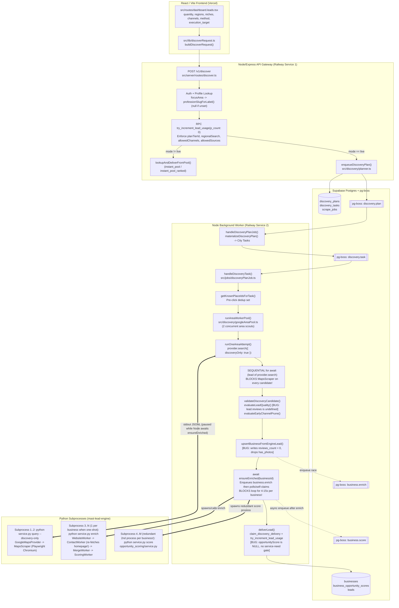
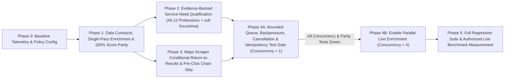

# MAST Live Discovery Engine Rebuild — Critical Technical Blueprint (v3, Policy-Aligned & Verified)
**Quality-First, Configuration-Aware, Ultra-Fast (`<120s` Benchmark Target on 2 Workers — Unproven Until Measured)**

---

## 1. Executive Summary & Core Product Principles

### 1.1 Product Premise & Mission
MAST is a general-purpose, configurable lead-intelligence engine for freelancers and agencies built on a single core promise:
> **"We deliver businesses that genuinely need the services the user offers."**

We are not building a coffee-shop scraper or a generic business directory exporter. A business is a valid MAST lead only if:
1. **Business Relevance & Eligibility**: It is a real, open, non-disqualified business matching the user's selected **niche(s)** and **geography** (`region` / `country` / `city` / `area`) and passing existing quality policies.
2. **Observable Service-Need Evidence**: It exhibits **verifiable, non-fabricated service-need signals** grounded in real inspection facts (`MapsScraper`, `WebsiteWorker`, `ContactWorker`, `InstagramWorker`)—never invented defaults or guessed probabilities.
3. **Contact Completeness**: It satisfies **every contact channel** explicitly requested by the user (`email`, `phone`, `website`, `instagram`) with validated, non-fabricated contact values. Contact completeness never substitutes for service need.
4. **Deduplication & Plan Integrity**: It honors the user's billing plan (`planTierId`, `regionalSearch`, `allowedChannels`, `allowedSources`, `dailyLeadLimit`, `monthlyLeadLimit`, worker concurrency caps) and has not already been delivered to the requesting user.

### 1.2 Critical Self-Review: Verified Code Facts vs. Hypotheses
In auditing the codebase end-to-end, we verified **eight critical code facts** that explain current latency and quality gaps without inventing arbitrary rules:

1. **Verified Fact 1 — `DEFAULT_LEAD_QUALITY_POLICY` (`{ minRating: 4.0, minReviewCount: 20 }`) Is Currently Bypassed on `minReviewCount` in Live Discovery**:
   - [`src/lib/leadQualityPolicy.ts`](file:///c:/bebo/graphic/mast-os-main/mast-os-main/src/lib/leadQualityPolicy.ts#L31-L39) defines `DEFAULT_LEAD_QUALITY_POLICY = { minRating: 4.0, minReviewCount: 20 }` (also passed to SQL `pool_lookup` as `POOL_QUALITY_ARGS`). Unknown (`null`) values never reject.
   - Because [`mast-lead-engine/service.py:_candidate_dict()`](file:///c:/bebo/graphic/mast-os-main/mast-os-main/mast-lead-engine/service.py#L644) emits `"review_count"` while [`src/jobs/discoveryPlanJob.ts`](file:///c:/bebo/graphic/mast-os-main/mast-os-main/src/jobs/discoveryPlanJob.ts#L485) passes `reviews: lead.reviews` (`undefined`) to `evaluateLeadQuality()`, `observedReviewCount(lead.reviews)` always returns `null` (unknown) during Live Discovery, **bypassing the `minReviewCount: 20` gate** and inserting `businesses.reviews_count = 0` ([`deliverLead.ts`](file:///c:/bebo/graphic/mast-os-main/mast-os-main/src/scraperBridge/deliverLead.ts#L272)).
2. **Verified Fact 2 — Canonical Profession Slugs & `focusArea = null` Semantics (`src/lib/professions.ts` & `src/lib/poolLookup.ts`)**:
   - [`src/lib/professions.ts`](file:///c:/bebo/graphic/mast-os-main/mast-os-main/src/lib/professions.ts#L3-L16) and [`mast-lead-engine/opportunity_scoring/professions.py`](file:///c:/bebo/graphic/mast-os-main/mast-os-main/mast-lead-engine/opportunity_scoring/professions.py#L14-L32) define the exact 12 canonical slugs seeded in Postgres (`migrations/001_opportunity_engine.sql`): `graphic_design`, `digital_marketing`, `writing_translation`, `video_animation`, `music_audio`, `programming_tech`, `data`, `business`, `personal_growth_hobbies`, `photography`, `finance`, `end_to_end_project`.
   - When `profile.settings.focusArea` is unset, [`src/server/routes/discover.ts`](file:///c:/bebo/graphic/mast-os-main/mast-os-main/src/server/routes/discover.ts#L248) sets `professionSlug = null`. Per [`src/lib/poolLookup.ts`](file:///c:/bebo/graphic/mast-os-main/mast-os-main/src/lib/poolLookup.ts#L146) and [`src/scraperBridge/deliverLead.ts`](file:///c:/bebo/graphic/mast-os-main/mast-os-main/src/scraperBridge/deliverLead.ts#L298-L299), when `professionSlug` is `null`, all 12 profession scores are still computed and stored in `business_opportunity_scores` for the Global Lead Pool, while the user's `leads` row stores `profession_slug = null` and `opportunity_score = null` (never silently substituting an unrelated profession). However, when `professionSlug` **is** set in Live Discovery, [`discoveryPlanJob.ts`](file:///c:/bebo/graphic/mast-os-main/mast-os-main/src/jobs/discoveryPlanJob.ts#L601-L609) currently forgets to pass `opportunityScore` to `deliverLead()`, leaving `leads.opportunity_score = null` even for users with an active `focusArea`!
3. **Verified Fact 3 — `enrich-daemon` & `ScoringWorker` Already Exist, But Node Spawns a Redundant Second `service.py score` Subprocess Due to Incomplete Input Payload**:
   - [`mast-lead-engine/service.py:_enrich_daemon_cli()`](file:///c:/bebo/graphic/mast-os-main/mast-os-main/mast-lead-engine/service.py#L2451-L2524) already supports `asyncio.Semaphore(16)` + thread-pool execution, and [`PersistentEnrichmentBridge`](file:///c:/bebo/graphic/mast-os-main/mast-os-main/src/scraperBridge/pythonBridge.ts#L903-L942) already multiplexes concurrent requests.
   - [`mast-lead-engine/engine_enrichment_bridge.py:enrich_business_with_engine_v2()`](file:///c:/bebo/graphic/mast-os-main/mast-os-main/mast-lead-engine/engine_enrichment_bridge.py#L146-L229) **already calls `ScoringWorker().process(enriched)`** and returns `profession_scores`, `opportunity_score`, and `score_breakdown`.
   - **Why Score Parity Currently Diverges Between `enrich` and `score`**:
     1. [`src/jobs/businessProcessingJob.ts`](file:///c:/bebo/graphic/mast-os-main/mast-os-main/src/jobs/businessProcessingJob.ts#L402) calls `runEngineEnrich({ website: business.website })` with **only** `{ website }`, omitting `id`, `name`, `category`, `rating`, `review_count`, `has_photos`, `phone`, and `instagram`.
     2. [`mast-lead-engine/workers/scoring_worker.py`](file:///c:/bebo/graphic/mast-os-main/mast-os-main/mast-lead-engine/workers/scoring_worker.py#L314-L332) constructs `biz_payload` with hardcoded `"has_photos": False`, `"load_time_ms": None`, omits `"seo"` and `"blog"`, and only checks `business.instagram_url` (ignoring `contact_intel.instagram_url` discovered on the website).
     3. [`businessProcessingJob.ts`](file:///c:/bebo/graphic/mast-os-main/mast-os-main/src/jobs/businessProcessingJob.ts#L480) then discards `site.profession_scores` and calls [`computeAndStoreOpportunityScores(businessId)`](file:///c:/bebo/graphic/mast-os-main/mast-os-main/src/scoring/storeOpportunityScores.ts#L20), which spawns a **second cold `python service.py score` subprocess** (`1.5s–3.5s` overhead).
     4. Furthermore, [`businessProcessingJob.ts`](file:///c:/bebo/graphic/mast-os-main/mast-os-main/src/jobs/businessProcessingJob.ts#L395) reserves `20` PIDs (`trySharedPidAdmission(env.ENRICHMENT_PIDS_PER_WORKER, "enrichment")`) even when `USE_PERSISTENT_ENRICHMENT=true` (where `0` new child processes are spawned).
4. **Verified Fact 4 — Double Homepage HTTP Fetch & Discarded Signals Between `WebsiteWorker` and `ContactWorker`**:
   - [`WebsiteWorker.process()`](file:///c:/bebo/graphic/mast-os-main/mast-os-main/mast-lead-engine/workers/website_worker.py#L276) fetches the homepage (`item.website`), extracts `title`, `description`, `detected_platform`, and `contact_page`, and **discards the HTML body**.
   - Immediately afterward, [`ContactWorker.process()`](file:///c:/bebo/graphic/mast-os-main/mast-os-main/mast-lead-engine/workers/contact_worker.py#L615) **fetches `item.final_url` (the exact same homepage URL) a second time over HTTP** to scan for emails, phones, and Instagram links.
   - Passing `homepage_html` in-memory on `WebsiteIntel` eliminates 100% of duplicate homepage HTTP requests and allows `WebsiteWorker` to run existing pure-HTML analyzers from [`mast-lead-engine/enrichment/site_crawler.py`](file:///c:/bebo/graphic/mast-os-main/mast-os-main/mast-lead-engine/enrichment/site_crawler.py) (`_detect_seo_signals`, `_detect_blog_signal`, `detect_tech_stack`, `_detect_growth_signals`) at **zero additional network cost**.
5. **Verified Fact 5 — Live Discovery Enqueues a Background `business.enrich` Job and Immediately Races/Polls Itself (`1,000ms` Sleep Loop)**:
   - [`src/jobs/discoveryPlanJob.ts`](file:///c:/bebo/graphic/mast-os-main/mast-os-main/src/jobs/discoveryPlanJob.ts#L540-L559) calls `await enqueueBusinessProcessing(businessId, "enrich")` and 1ms later calls `await ensureEnriched(businessId)`. If the background `businessEnrich` worker claims the row first, `ensureEnriched()` falls into a `1,000ms` polling sleep loop ([`businessProcessingJob.ts`](file:///c:/bebo/graphic/mast-os-main/mast-os-main/src/jobs/businessProcessingJob.ts#L329)).
6. **Verified Fact 6 — Sequential Blocking Inside `runOneAreaAttempt`**:
   - [`src/jobs/discoveryPlanJob.ts`](file:///c:/bebo/graphic/mast-os-main/mast-os-main/src/jobs/discoveryPlanJob.ts#L403-L610) runs a strictly serial `for await (const lead of provider.search(...))` loop that awaits `ensureEnriched(businessId)` on every single candidate before reading the next candidate from the scout stream.
7. **Verified Fact 7 — Conditional `_return_to_results()` Check Required in `maps_scraper.py`**:
   - In [`mast-lead-engine/scraper/maps_scraper.py`](file:///c:/bebo/graphic/mast-os-main/mast-os-main/mast-lead-engine/scraper/maps_scraper.py#L3256), the post-card `finally` block unconditionally runs `_return_to_results()` (`Escape` + 11 selector probes + `history.back()`). We must only skip `_return_to_results()` when `panel_sel` (`div[role='feed']`) is verified still attached in the DOM with `>1` `a[href*='/maps/place/']` anchors; otherwise we must fall back to `_return_to_results()`.
8. **Verified Fact 8 — Existing Chain & Scale Disqualification Rules Must Be Preserved**:
   - Chain/cannabis disqualification (`_is_cannabis(name, category) or _is_chain(name)` via [`utils/parsing.py`](file:///c:/bebo/graphic/mast-os-main/mast-os-main/mast-lead-engine/utils/parsing.py) and [`workers/scoring_worker.py`](file:///c:/bebo/graphic/mast-os-main/mast-os-main/mast-lead-engine/workers/scoring_worker.py#L323)) and Instagram scale disqualification (`instagram_intel.followers > 100_000` in [`workers/qualification_worker.py`](file:///c:/bebo/graphic/mast-os-main/mast-os-main/mast-lead-engine/workers/qualification_worker.py#L258-L269)) are already established deterministic rules in the codebase and will be preserved with configurable policy flags.

---

## 2. Evidence Ledger: Verified Facts vs. Hypotheses vs. Estimates

| ID | Finding / Claim | Classification | Concrete Code / Telemetry Evidence | Verification Requirement |
| :--- | :--- | :--- | :--- | :--- |
| **E-1** | `discoveryPlanJob.ts` runs `provider.search({ discoveryOnly: true })` and blocks its `for await` loop on `await ensureEnriched(businessId)` sequentially per candidate. | **Verified Code Fact** | [`src/jobs/discoveryPlanJob.ts`](file:///c:/bebo/graphic/mast-os-main/mast-os-main/src/jobs/discoveryPlanJob.ts#L367-L560). Confirmed in production run `8b57d79d` (`157s–238s` serial wait). | Concurrency, backpressure, and cancellation tests (`discoveryConcurrency.test.ts`) before enabling parallel enrichment. |
| **E-2** | `service.py:_candidate_dict()` emits `"review_count"`, while Node's `EngineLead`, `evaluateLeadQuality`, and `upsertBusinessFromEngineLead` read `lead.reviews`. | **Verified Code Fact (Bug)** | [`service.py`](file:///c:/bebo/graphic/mast-os-main/mast-os-main/mast-lead-engine/service.py#L644) vs. [`discoveryPlanJob.ts`](file:///c:/bebo/graphic/mast-os-main/mast-os-main/src/jobs/discoveryPlanJob.ts#L485) & [`deliverLead.ts`](file:///c:/bebo/graphic/mast-os-main/mast-os-main/src/scraperBridge/deliverLead.ts#L272). | Unit & integration test verifying `lead.reviews` populates `businesses.reviews_count` and triggers `evaluateLeadQuality`. |
| **E-3** | Live Discovery never passes `opportunityScore` to `deliverLead()` (even when `professionSlug` is set) and skips `evaluate_niche_relevance` when `discoveryOnly: true`. | **Verified Code Fact (Bug)** | [`discoveryPlanJob.ts`](file:///c:/bebo/graphic/mast-os-main/mast-os-main/src/jobs/discoveryPlanJob.ts#L601-L609) & [`deliverLead.ts`](file:///c:/bebo/graphic/mast-os-main/mast-os-main/src/scraperBridge/deliverLead.ts#L299). | Integration test asserting `leads.opportunity_score` matches `business_opportunity_scores` when `professionSlug` is set, and remains `null` when `professionSlug` is `null`. |
| **E-4** | `enrichBusiness()` passes only `{ website }` to `runEngineEnrich`, causing `ScoringWorker`'s scores to diverge from `computeAndStoreOpportunityScores()` and requiring a second cold `service.py score` subprocess. | **Verified Code Fact (Bug)** | [`businessProcessingJob.ts`](file:///c:/bebo/graphic/mast-os-main/mast-os-main/src/jobs/businessProcessingJob.ts#L402-L480) vs. [`scoring_worker.py`](file:///c:/bebo/graphic/mast-os-main/mast-os-main/mast-lead-engine/workers/scoring_worker.py#L314-L335) vs. [`storeOpportunityScores.ts`](file:///c:/bebo/graphic/mast-os-main/mast-os-main/src/scoring/storeOpportunityScores.ts#L23-L57). | Automated **Score Parity Test** (`scoreParity.test.ts` & `test_score_parity.py`) proving 100% bit-for-bit equality across all 12 `PROFESSION_SLUGS`. |
| **E-5** | `WebsiteWorker` fetches the homepage and discards the HTML body, causing `ContactWorker` to fetch the exact same homepage URL a second time over HTTP. | **Verified Code Fact** | [`website_worker.py`](file:///c:/bebo/graphic/mast-os-main/mast-os-main/mast-lead-engine/workers/website_worker.py#L365-L420) & [`contact_worker.py`](file:///c:/bebo/graphic/mast-os-main/mast-os-main/mast-lead-engine/workers/contact_worker.py#L615-L645). | Unit test verifying `ContactWorker` performs `0` HTTP GETs for the homepage when `WebsiteIntel.homepage_html` is present. |
| **E-6** | `ScoringWorker` hardcodes `"has_photos": False`, `"load_time_ms": None`, and omits `"seo"` and `"blog"`, while `businessProcessingJob.ts` omits `seo`, `blog`, and `website_is_weak` when updating `businesses`. | **Verified Code Fact (Bug)** | [`scoring_worker.py`](file:///c:/bebo/graphic/mast-os-main/mast-os-main/mast-lead-engine/workers/scoring_worker.py#L314-L332) & [`businessProcessingJob.ts`](file:///c:/bebo/graphic/mast-os-main/mast-os-main/src/jobs/businessProcessingJob.ts#L450-L463). | Unit test verifying `seo`, `blog`, `has_photos`, `load_time_ms`, `website_is_weak`, `tech_stack`, and `growth_signals` flow into `ScoringWorker` and `businesses`. |
| **E-7** | Bypassing `ensureStreetInventory` (Overpass API) when `hasCuratedAreas(city)` is true reduced scout startup time from `95.0s` to `12.0s`. | **Verified Production Telemetry** | Commit `abe81c5`; verified in Railway worker logs (`bcc7937d`). | Keep regression test in `discoveryPlanJob.test.ts`. |
| **H-1** | Skipping `_return_to_results()` when `div[role='feed']` remains attached with `>1` place anchors will save `1.2s–2.5s` per card. | **Hypothesis (High Confidence)** | [`maps_scraper.py`](file:///c:/bebo/graphic/mast-os-main/mast-os-main/mast-lead-engine/scraper/maps_scraper.py#L1210-L1308). | Verify via `[maps][diag]` counters (`return_to_results_skipped` vs. `return_to_results_executed`) in live tests. |
| **H-2** | Running `InstagramWorker` inline (`2.5s` timeout) when `ContactWorker` discovers an IG URL on the website will populate follower/recency signals when reachable without blocking on login walls. | **Hypothesis (Medium Confidence)** | [`instagram_worker.py`](file:///c:/bebo/graphic/mast-os-main/mast-os-main/mast-lead-engine/workers/instagram_worker.py#L285-L305) returns `profile_reachable=None, profile_status="blocked"` on `/accounts/login`. | Verify non-blocking fallback when Instagram serves a login wall. |
| **P-1** | Delivering 10 unique, service-need-qualified US coffee shops with all 4 channels in `<120s` on 2 workers. | **Unproven Performance Target** | Derived from stage latency math (Section 11). | **Remains unproven until an authorized live run measures it.** |

---

## 3. Current Architecture Diagram & Verified End-to-End Request Flow

---

## 4. End-to-End Configuration & Data Contract Audit

### 4.1 Complete Inventory of User-Facing, Profile & Plan Configuration

| Configuration / Setting | Source of Truth | API Validation (`discover.ts`) | Planner (`planner.ts`) | Worker / Engine Consumption | Unset / Default Semantics & Required Fix |
| :--- | :--- | :--- | :--- | :--- | :--- |
| **`niche`** (Any string or comma-separated list from `NICHE_CATALOG` or custom input) | Request payload `body.niche` | `DiscoverRequestSchema.niche` (`1..200` chars) | `splitNicheQuery(niche)` -> `expandQueries()` -> `discovery_tasks.niche` & `query` | Passed to `MapsScraper.search(niche=...)` and `BusinessCandidate.requested_niche` | **Required (never unset)**. **Fix**: Evaluate `evaluate_niche_relevance(requested_niche, category, name)` (`opportunity_qualification/niche_relevance.py`) in `_candidate_dict()` / Live Discovery even when `discoveryOnly: true`. Clear mismatch rejects (`"niche_mismatch"`); ambiguous/missing category never rejects. |
| **`region` / `regions`** (Global, Continent, Country, or City) | Request payload `body.region` / `body.regions` + `plan.regionalSearch` | `normalizeRegion(body)` + `validateDiscoveryRegion(region, { regionalSearch: plan.regionalSearch })` | `resolveDiscoveryTargets(region)` -> countries -> `selectCitiesForExecution()` -> curated areas in `cityAreas.ts` | `discovery_tasks.city`, `country`, and claimed `area` passed to `MapsScraper` | Preserves existing plan gating (`403` if user's plan disallows regional search) and strict country isolation (`resolveBusinessCountryCode`). |
| **`quantity`** (`1..500`, clamped by plan quota) | Request payload `body.quantity` + `plans.ts` (`dailyLeadLimit`, `monthlyLeadLimit`) | `Math.min(body.quantity, dailyRemaining, monthlyRemaining)` | `discovery_plans.target_leads = quantity`; `computeGlobalScanBudget()` | Enforced atomically by `claim_discovery_delivery(p_plan_id)` | Preserves existing quota clamp and atomic delivery cap. |
| **`channels`** (`email`, `phone`, `instagram`, `website`, or `[]`) | Request payload `body.channels` + `plan.allowedChannels` (`src/config/plans.ts`) | Checked against `plan.allowedChannels` (`403` if disallowed) | Stored in `discovery_plans.request.channels` | Pre-upsert: `evaluateEarlyChannelPrune()` checks `phone`/`website`. Post-enrichment: `channelsSatisfied()` checks all requested channels with AND semantics. | **When `channels` is `[]` (unset/empty)**: `channelsSatisfied(biz, [])` returns `true` (no specific channel forced), while `QualificationWorker._has_any_contact_method` ensures at least one reachable contact method exists. **Fix**: Add `engineWebsiteRequiredForChannels(channels)` so the Maps scraper fast-aborts no-website cards whenever `channels` includes `"website"`, `"email"`, or `"instagram"` (since live email/IG extraction requires crawling the business website), while keeping `requireWebsite = false` when `channels` is `["phone"]` or `[]`. |
| **`focusArea` -> `professionSlug`** (12 canonical slugs in `src/lib/professions.ts` or `null`) | User's `profiles.settings.focusArea` | `professionSlugForLabel(focusAreaLabel)` (`discover.ts` line 248) -> returns canonical `ProfessionSlug` or `null` | Stored in `discovery_plans.profession_slug` and `request.professionSlug` | Used for `business_opportunity_scores`, service-need qualification, and `deliverLead()` (`leads.profession_slug`, `leads.opportunity_score`). | **When `focusArea` is unset (`professionSlug === null`)**: Do **not** silently substitute another profession. Compute and store all 12 `business_opportunity_scores` rows for the pool, evaluate universal business opportunity gaps (`UniversalBreakdown` / `QualificationWorker._collect_business_problems`), and persist `leads.profession_slug = null` and `leads.opportunity_score = null`. **When `professionSlug` is set**: Evaluate profession-weighted service need for `professionSlug` and persist `leads.opportunity_score = profession_scores[professionSlug].score`. |
| **`planTierId`** (`"free"`, `"starter"`, `"pro"`, `"agency"`) | User's active subscription / `getPlan()` | Passed as `planTierId: plan.id` in `discover.ts` line 302 | Sets `discovery_plans.plan_tier_id` and task priority band (`materializeDiscoveryPlan`) | Enforces per-user concurrent worker cap via `getPlanConcurrency(planTierId)` | **Preserved 100% untouched**. |
| **`mode` / `execution_target`** (`"live"`, `"instant_pool"`, `"instant_pool_ranked"`, `"cloud"`, `"desktop"`) | Request payload `body.mode` & `body.execution_target` | Validated by `DiscoverRequestSchema` (`execution_target` defaults to `"cloud"`) | `mode === "live"` -> `enqueueDiscoveryPlan()`; pool modes -> `lookupAndDeliverFromPool()` | Worker executes `discoveryPlanJob` for `"live"` | **Preserved 100% untouched**. |
| **`method`** (`"google_maps"`, `"instagram"`, `"linkedin"`, `"yelp"`, `"All"`) | Request payload `body.method` + `plan.allowedSources` | Validated against `plan.allowedSources` (`discover.ts` line 175) | Preserve `method` in `discovery_plans.request` and resolve via `providerRegistry` | `google_maps` is the registered live provider | Preserves `plan.allowedSources` check and passes `method` cleanly without silent drop. |
| **Quality Policy (`minRating`, `minReviewCount`, `excludeChains`, `maxIgFollowers`)** | [`src/lib/leadQualityPolicy.ts`](file:///c:/bebo/graphic/mast-os-main/mast-os-main/src/lib/leadQualityPolicy.ts) (`minRating: 4.0`, `minReviewCount: 20`), [`scoring_worker.py`](file:///c:/bebo/graphic/mast-os-main/mast-os-main/mast-lead-engine/workers/scoring_worker.py#L323) (`_is_chain`, `_is_cannabis`), [`qualification_worker.py`](file:///c:/bebo/graphic/mast-os-main/mast-os-main/mast-lead-engine/workers/qualification_worker.py#L258) (`followers > 100_000`) | Server-side documented defaults (configurable via policy/env overrides) | Passed to `pool_lookup` via `POOL_QUALITY_ARGS` and evaluated in `discoveryPlanJob.ts` | `evaluateLeadQuality()`, `validateDiscoveryCandidate()`, and post-enrichment follower check | **Fix**: Fix `lead.reviews` mapping so `minReviewCount: 20` is enforced on observed review counts in Live Discovery (while `null` / unknown never rejects). Preserve `excludeChains = true` and `maxIgFollowers = 100_000` defaults with configurable policy overrides. |

### 4.2 End-to-End Data Contract Mismatches & Exact Fixes

| Boundary | Source Field | Target Field | Current Mismatch / Defect | Exact Fix & Regression Test |
| :--- | :--- | :--- | :--- | :--- |
| **`RawPlace` -> `BusinessCandidate`** (`google_maps_provider.py` line 499) | `place.has_photos` `place.is_google_verified` `place.extra["maps_place_id"]` | *Missing on `BusinessCandidate`* `provider_business_id=None` | `BusinessCandidate` drops `has_photos` and `is_google_verified`, and sets `provider_business_id=None` even though `maps_scraper.py` line 3182 populated `place.extra["maps_place_id"]`. | Add `has_photos: Optional[bool] = None` and `is_google_verified: Optional[bool] = None` to `BusinessCandidate` (`engine/contracts.py`) and map `provider_business_id = _or_none(place.extra.get("maps_place_id"))`. Tested in `test_google_maps_provider.py`. |
| **`BusinessCandidate` -> `_candidate_dict()` -> `EngineLead`** (`service.py` line 630 -> `pythonBridge.ts` line 55) | `candidate.review_count` `candidate.maps_url` | `lead.reviews` `lead.maps_url` | `_candidate_dict()` emits `"review_count"` (not `"reviews"`) and `"maps_link"`. `lead.reviews` is `undefined` in Node, breaking `evaluateLeadQuality` and setting `businesses.reviews_count = 0`. | Emit **both** `"reviews": candidate.review_count` and `"review_count": candidate.review_count`, plus `"has_photos"`, `"is_google_verified"`, `"maps_place_id"`, and `"niche_relevant"`. Map `reviews: raw.reviews ?? raw.review_count` in `pythonBridge.ts`. Tested in `discoveryContract.test.ts`. |
| **`WebsiteWorker` -> `ContactWorker`** (`website_worker.py` -> `contact_worker.py`) | Homepage `html` fetched by `WebsiteWorker` | `_fetch(item.final_url)` in `ContactWorker` | `WebsiteIntel` does not carry the homepage HTML body, forcing `ContactWorker` to perform a second HTTP GET to the exact same homepage URL. | Add optional `homepage_html: Optional[str] = None` to `WebsiteIntel` (`engine/contracts.py`); `ContactWorker` inspects `item.homepage_html` in-memory (`0ms`) and only fetches `item.contact_page` if needed. Tested in `test_contact_worker.py`. |
| **`businessProcessingJob.ts` -> `runEngineEnrich` -> `ScoringWorker`** | `businesses` row + `WebsiteIntel` + `ContactIntel` + `InstagramIntel` | `ScoringWorker.process()` -> `OpportunityScoringService.evaluate_business_professions()` | `businessProcessingJob.ts` passes only `{ website }` to `runEngineEnrich`. `ScoringWorker.process()` hardcodes `"has_photos": False`, `"load_time_ms": None`, omits `"seo"` and `"blog"`, and ignores `contact_intel.instagram_url`. | Pass full business fields (`id, name, category, website, phone, instagram, rating, review_count, has_photos, facebook, linkedin, signals`) to `runEngineEnrich`, and populate `ScoringWorker`'s `biz_payload` with identical fields to `computeAndStoreOpportunityScores()`. Verified by **Score Parity Tests** (`scoreParity.test.ts`). |
| **`discoveryPlanJob.ts` -> `deliverLead()`** (`discoveryPlanJob.ts` line 601) | `profession_scores[professionSlug].score` | `leads.opportunity_score` | `discoveryPlanJob.ts` never passes `opportunityScore` to `deliverLead()`, so every live-discovered lead has `leads.opportunity_score = NULL`. | When `payload.request.professionSlug` is non-null, pass `opportunityScore: professionScores[professionSlug]?.score ?? null` to `deliverLead()`; when `professionSlug` is `null`, pass `null`. Tested in `discoveryPlanJob.test.ts`. |

---

## 5. Protecting Lead Quality: Existing Scoring Semantics & Evidence-Backed Qualification

### 5.1 Establishing Existing Scoring & Qualification Semantics (Zero Arbitrary Defaults)
Rather than inventing an arbitrary universal minimum score threshold (which would ignore profession weight differences and user configuration), we align Live Discovery directly with MAST's existing canonical scoring and qualification architecture in [`mast-lead-engine/opportunity_scoring/service.py`](file:///c:/bebo/graphic/mast-os-main/mast-os-main/mast-lead-engine/opportunity_scoring/service.py), [`mast-lead-engine/opportunity_scoring/explain.py`](file:///c:/bebo/graphic/mast-os-main/mast-os-main/mast-lead-engine/opportunity_scoring/explain.py), and [`mast-lead-engine/workers/qualification_worker.py`](file:///c:/bebo/graphic/mast-os-main/mast-os-main/mast-lead-engine/workers/qualification_worker.py):

1. **Stage A — Deterministic Eligibility & Disqualification Gates (Binary)**:
   - **Open Business**: Reject if `closed === true` (`"closed_business"`).
   - **Hard Disqualifiers (`is_disqualified`)**: Preserves [`workers/scoring_worker.py`](file:///c:/bebo/graphic/mast-os-main/mast-os-main/mast-lead-engine/workers/scoring_worker.py#L291-L323) and [`utils/parsing.py`](file:///c:/bebo/graphic/mast-os-main/mast-os-main/mast-lead-engine/utils/parsing.py):
     - Cannabis businesses (`_is_cannabis(name, category) === true`) -> disqualified.
     - Major chains (`_is_chain(name) === true` when `policy.excludeChains === true`, which defaults to `true`) -> disqualified.
   - **Niche Relevance Gate**: Preserves [`opportunity_qualification/niche_relevance.py`](file:///c:/bebo/graphic/mast-os-main/mast-os-main/mast-lead-engine/opportunity_qualification/niche_relevance.py) (`QualificationWorker` lines 246–256):
     - Clear match -> pass; ambiguous/missing category -> keep; clear mismatch -> reject (`"niche_mismatch"`).
   - **Internal Lead Quality Policy**: Preserves [`src/lib/leadQualityPolicy.ts`](file:///c:/bebo/graphic/mast-os-main/mast-os-main/src/lib/leadQualityPolicy.ts):
     - `DEFAULT_LEAD_QUALITY_POLICY = { minRating: 4.0, minReviewCount: 20 }`.
     - If `rating` is observed `< 4.0` -> reject (`"rating_below_4"`).
     - If `reviews` (`review_count`) is observed `> 0` and `< 20` -> reject (`"reviews_below_20"`).
     - Unknown (`null` or `0` extraction miss) never rejects.
   - **SMB Scale Gate**: Preserves [`workers/qualification_worker.py`](file:///c:/bebo/graphic/mast-os-main/mast-os-main/mast-lead-engine/workers/qualification_worker.py#L258-L269) Rule 5:
     - If `instagram_intel.followers` is observed and `> 100_000` (`policy.maxIgFollowers`) -> reject (`"instagram_followers_over_limit"`). Unknown (`None`) never rejects.
   - **Contact Completeness Gate**: Preserves [`src/lib/channelFilter.ts`](file:///c:/bebo/graphic/mast-os-main/mast-os-main/src/lib/channelFilter.ts):
     - All user-requested `channels` (`email`, `phone`, `website`, `instagram`) must be present and valid (`isValidEmail`, `isValidPhone`, `isValidWebsite`, `isValidInstagram`).
     - If `channels` is `[]` (empty), requires at least one valid contact method (`QualificationWorker._has_any_contact_method`).

2. **Stage B — Non-Fabrication & Handling Missing/Inconclusive Evidence**:
   - Every signal extractor strictly distinguishes **`False` (inspected and confirmed absent)** from **`None` / `null` (not inspected or inconclusive due to network timeout/block)**:
     - If a website exists on the candidate (`website` is non-empty) but the HTTP fetch failed or timed out (`website_reachable === False`), `seo`, `blog`, and `tech_stack` **must remain `None`**, never `{"has_title": False}` or `{"chat": None}`.
     - In [`opportunity_scoring/service.py`](file:///c:/bebo/graphic/mast-os-main/mast-os-main/mast-lead-engine/opportunity_scoring/service.py) and [`src/scoring/opportunityScore.ts`](file:///c:/bebo/graphic/mast-os-main/mast-os-main/src/scoring/opportunityScore.ts):
       - When `seo` is `None` (unknown/unreachable), `good_seo = True` (0 fabricated branding penalty).
       - When `ig_last_post_days` is `None` (unknown because Instagram returned a login wall), `compute_social_opportunity()` returns `40.0` (neutral unknown value, never `85.0` or `100.0`).
       - When a website URL exists (`biz.website` is non-empty) but `website_reachable === False` (`tech_stack` is `None`), `compute_tech_opportunity()` returns `40.0` (inconclusive) rather than `100.0` ("missing chat, booking, and analytics") because the HTML could not be inspected.

3. **Stage C — Evidence-Backed Service-Need Qualification Across All 12 Supported Professions**:
   - In [`opportunity_scoring/service.py`](file:///c:/bebo/graphic/mast-os-main/mast-os-main/mast-lead-engine/opportunity_scoring/service.py#L280-L309) and [`opportunity_scoring/explain.py`](file:///c:/bebo/graphic/mast-os-main/mast-os-main/mast-lead-engine/opportunity_scoring/explain.py#L174-L244), `OpportunityScoringService.evaluate_business_professions()` computes the 6 universal components (`website`, `branding`, `social`, `growth`, `newness`, `tech`) and calls `explain_opportunity(biz_data, score, breakdown, slug)`.
   - `explain_opportunity()` ranks each component by its weighted contribution (`value * weight_map[component]`) and emits an `ExplanationReason` for every component where `contribution > 5.0` (up to the top 3 reasons). If no component achieves `contribution > 5.0`, `reasons` is empty (`()`) and `summary` states: *"This business scored low for your profession — limited overlap with the signals that matter most here."*
   - **Canonical Service-Need Qualification Rule (No Arbitrary Universal Score Cutoff)**:
     - **When `professionSlug` is set (`1` of the `12` canonical slugs)**:
       A business qualifies as having genuine service need for `professionSlug` if and only if:
       1. `is_disqualified === False`,
       2. `explain_opportunity(..., professionSlug).reasons` is **non-empty** (`len(reasons) >= 1`, meaning at least one profession-relevant dimension has `value * weight > 5.0`), **AND**
       3. At least one of those contributing `reasons` is backed by a **positively observed service-need fact** (not merely an uninspected/inconclusive `None` fallback), as defined for each profession in the table below.
       4. *(Optional caller filter)*: If a request explicitly specifies an optional `minOpportunityScore` override, `profession_scores[professionSlug].score >= minOpportunityScore` is also enforced; when unset, no arbitrary universal score number is imposed.
     - **When `professionSlug` is `null` (`focusArea` unset in user profile)**:
       - No unrelated profession is substituted.
       - The business must have `is_disqualified === False` and at least one positively observed universal business gap in `UniversalBreakdown` (`website` missing/weak/invalid-SSL/slow, `branding` missing photos or missing SEO title/meta on a crawled page, `social` missing or dormant `> 60` days, `tech` missing booking/chat/analytics on a crawled page, `growth` hiring/expansion signal, or `newness` emerging business `< 150` reviews).
       - All 12 `business_opportunity_scores` rows are persisted for the Global Lead Pool, while `leads.profession_slug = null` and `leads.opportunity_score = null` are written to `leads`.

| Canonical `ProfessionSlug` | Exact `PROFESSION_WEIGHTS` (`professions.py` & `professionWeights.ts`) | Positively Observed Service-Need Evidence That Qualifies the Lead (`contribution > 5.0` + Verified Fact) |
| :--- | :--- | :--- |
| **`graphic_design`** | `branding: 0.44`, `social: 0.19`, `newness: 0.15`, `website: 0.10`, `growth: 0.10`, `tech: 0.02` | • **Branding (`weight 0.44`)**: `has_photos === False` on Google Maps, or crawled website missing SEO basics (`!seo.has_title \|\| !seo.has_meta_description`), or `reviews_rating < 4.3` with weak visual presence. • **Social (`weight 0.19`)**: No social links found on website/Maps (`!instagram && !facebook && !linkedin`), or observed `ig_last_post_days > 30`. • **Newness (`weight 0.15`)**: Emerging business (`0 < reviews_count < 150`) needing brand identity. • **Website (`weight 0.10`)**: Missing website or templated builder (`website_is_weak === True`). |
| **`digital_marketing`** | `social: 0.38`, `branding: 0.19`, `website: 0.14`, `growth: 0.14`, `newness: 0.10`, `tech: 0.05` | • **Social (`weight 0.38`)**: No social presence detected on website, or dormant Instagram (`ig_last_post_days > 30`). • **Branding/SEO (`weight 0.19`)**: Crawled homepage missing `<title>` or `<meta name="description">`, or `has_photos === False`. • **Website (`weight 0.14`)**: No website, `website_is_weak === True`, or `ssl_valid === False`. • **Growth (`weight 0.14`)**: Active `growth_signals.hiring` or `growth_signals.new_location`. • **Tech (`weight 0.05`)**: Crawled homepage has no analytics/ad pixel (`tech_stack.analytics` empty). |
| **`writing_translation`** | `website: 0.29`, `branding: 0.19`, `social: 0.19`, `growth: 0.15`, `newness: 0.14`, `tech: 0.04` | • **Website (`weight 0.29`)**: Missing website, `website_is_weak === True`, or crawled site has no blog (`blog.has_blog === False`). • **Branding/Copy (`weight 0.19`)**: Crawled homepage missing meta description or title (`!seo.has_meta_description \|\| !seo.has_title`). • **Social (`weight 0.19`)**: Missing or dormant social channels (`ig_last_post_days > 30`). • **Growth (`weight 0.15`)**: Active hiring or new location expansion. |
| **`video_animation`** | `social: 0.34`, `branding: 0.29`, `newness: 0.15`, `website: 0.10`, `growth: 0.10`, `tech: 0.02` | • **Social (`weight 0.34`)**: Missing social channels or dormant Instagram (`ig_last_post_days > 30`). • **Branding (`weight 0.29`)**: `has_photos === False`, missing SEO metadata on crawled homepage, or weak visual presence. • **Newness (`weight 0.15`)**: Early-stage business (`reviews_count < 150`). |
| **`music_audio`** | `social: 0.34`, `branding: 0.24`, `website: 0.15`, `newness: 0.15`, `growth: 0.10`, `tech: 0.02` | • **Social (`weight 0.34`)**: Missing social presence or dormant Instagram (`ig_last_post_days > 30`). • **Branding (`weight 0.24`)**: `has_photos === False` or missing SEO metadata. • **Website (`weight 0.15`)**: Missing or templated website (`website_is_weak === True`). • **Newness (`weight 0.15`)**: Early-stage business (`reviews_count < 150`). |
| **`programming_tech`** | `website: 0.40`, `tech: 0.27`, `growth: 0.11`, `newness: 0.10`, `branding: 0.06`, `social: 0.06` | • **Website (`weight 0.40`)**: Missing website, `website_is_weak === True` (Linktree, Wixsite, Square.site, etc.), `ssl_valid === False`, or slow response (`load_time_ms > 4000`). • **Tech (`weight 0.27`)**: Crawled website (`website_reachable === True`) is missing online booking (`!tech_stack.booking`), chat widget (`!tech_stack.chat`), or analytics (`!tech_stack.analytics`). • **Growth (`weight 0.11`)**: Active hiring or new-location signals. |
| **`data`** | `website: 0.29`, `growth: 0.27`, `tech: 0.15`, `newness: 0.13`, `branding: 0.08`, `social: 0.08` | • **Website (`weight 0.29`)**: Missing or weak website (`website_is_weak === True`), `ssl_valid === False`, or `load_time_ms > 4000`. • **Growth (`weight 0.27`)**: Active `growth_signals.hiring` or `new_location`. • **Tech (`weight 0.15`)**: Crawled website missing analytics/tracking (`!tech_stack.analytics`) or automation tooling. |
| **`business`** | `growth: 0.27`, `tech: 0.20`, `website: 0.15`, `branding: 0.15`, `newness: 0.13`, `social: 0.10` | • **Growth (`weight 0.27`)**: Active hiring or new-location expansion signals. • **Tech (`weight 0.20`)**: Crawled website missing booking, chat, or analytics tooling. • **Website/Branding (`0.15` each)**: Missing/weak website or missing SEO/branding basics. |
| **`personal_growth_hobbies`** | `branding: 0.29`, `social: 0.29`, `website: 0.19`, `newness: 0.15`, `growth: 0.06`, `tech: 0.02` | • **Branding (`weight 0.29`)**: `has_photos === False` or missing SEO basics on crawled site. • **Social (`weight 0.29`)**: Missing or dormant social channels (`ig_last_post_days > 30`). • **Website (`weight 0.19`)**: Missing or templated website (`website_is_weak === True`). |
| **`photography`** | `branding: 0.37`, `social: 0.30`, `newness: 0.20`, `website: 0.05`, `growth: 0.06`, `tech: 0.02` | • **Branding (`weight 0.37`)**: `has_photos === False` on Google Maps, or weak visual/brand presence. • **Social (`weight 0.30`)**: Missing Instagram/social links or dormant Instagram (`ig_last_post_days > 30`). • **Newness (`weight 0.20`)**: Newer/smaller business (`reviews_count < 150`) building visual assets. |
| **`finance`** | `growth: 0.36`, `newness: 0.23`, `website: 0.14`, `tech: 0.10`, `branding: 0.09`, `social: 0.08` | • **Growth (`weight 0.36`)**: Active hiring (`growth_signals.hiring`) or opening a new location (`growth_signals.new_location`). • **Newness (`weight 0.23`)**: Earlier-stage business (`reviews_count < 150`). • **Website/Tech (`0.14 / 0.10`)**: Weak website or missing operational/booking/analytics tooling. |
| **`end_to_end_project`** | `website: 0.18`, `branding: 0.18`, `social: 0.18`, `growth: 0.18`, `newness: 0.18`, `tech: 0.10` | • Balanced across all 6 dimensions: any ≥1 positively observed gap across Website, Branding, Social, Growth, Newness, or Tech with `contribution > 5.0`. |

---

## 6. Score Parity Verification Across Python, Postgres & Live Qualification

### 6.1 Root Cause of Historical Score Drift
Previously, MAST had three places touching Opportunity Scores:
1. `ScoringWorker.process(enriched)` inside `mast-lead-engine/workers/scoring_worker.py` (called during `service.py enrich` / `enrich-daemon`).
2. `OpportunityScoringService.evaluate_business_professions(biz_data)` inside `mast-lead-engine/opportunity_scoring/service.py` (called both by `ScoringWorker.process()` AND by `service.py score` via `computeAndStoreOpportunityScores()`).
3. `computeOpportunityScores(b)` inside `src/scoring/opportunityScore.ts` (TypeScript implementation, which had minor input-key differences like `tech.booking` vs `tech.has_booking_system`).

Even though both `ScoringWorker` and `service.py score` call the **exact same Python class** (`OpportunityScoringService.evaluate_business_professions()`), they produced different numbers because:
- `businessProcessingJob.ts:enrichBusiness()` only passed `{ website: business.website }` into `runEngineEnrich()`, leaving `name`, `category`, `rating`, `review_count`, `has_photos`, and `instagram` blank during `ScoringWorker.process()`.
- `ScoringWorker.process()` built `biz_payload` with hardcoded `"has_photos": False`, `"load_time_ms": None`, omitted `"seo"` and `"blog"`, and did not fall back to `contact_intel.instagram_url` when `business.instagram_url` was `None`.

### 6.2 How We Guarantee 100% Bit-for-Bit Score Parity
1. **Single Canonical Calculation Engine**: `OpportunityScoringService.evaluate_business_professions()` in [`mast-lead-engine/opportunity_scoring/service.py`](file:///c:/bebo/graphic/mast-os-main/mast-os-main/mast-lead-engine/opportunity_scoring/service.py) remains the single canonical owner of profession scoring.
2. **Identical Input Dictionary (`build_canonical_scoring_payload`)**:
   - Extract a shared pure helper `build_canonical_scoring_payload(candidate, website_intel, contact_intel, instagram_intel, existing_biz)` in `mast-lead-engine/opportunity_scoring/service.py` used by **both** `ScoringWorker.process()` (`enrich-daemon`) and `service.py score`.
   - `enrichBusiness()` and `enrichBusinessInlineForLive()` pass the full business row fields (`id`, `name`, `category`, `website`, `phone`, `instagram`, `facebook`, `linkedin`, `rating`, `review_count`, `has_photos`, `signals`) to `runEngineEnrich()`.
   - `ScoringWorker.process()` populates `biz_payload` with the resolved `instagram` (`business.instagram_url` or `_website_instagram_url(contact_intel)`), `has_photos`, `reviews_count`, `reviews_rating`, `is_disqualified`, `website_is_weak`, `ssl_valid`, `load_time_ms`, `seo`, `blog`, and `signals` (`ig_last_post_days`, `tech_stack`, `growth_signals`).
3. **Mandatory Score Parity Test Suite (`test_score_parity.py` & `scoreParity.test.ts`)**:
   - Before removing the second `service.py score` subprocess call in `enrichBusiness()`, automated tests will feed 25 diverse business fixtures (missing website, weak Wix site, unreachable site, strong custom site, dormant IG, active hiring, chain disqualified, cannabis disqualified, etc.) through:
     1. `enrich_business_with_engine_v2()` (`ScoringWorker.process`),
     2. `service.py score` (`OpportunityScoringService.evaluate_business_professions` on the persisted `businesses` row shape), and
     3. TypeScript `computeOpportunityScores()` in `src/scoring/opportunityScore.ts`.
   - The test asserts **exact equality** (`score`, ` universal_breakdown`, `reasons`, `summary`, and `is_disqualified`) across all 12 `PROFESSION_SLUGS` between `ScoringWorker`, `service.py score`, the persisted `business_opportunity_scores` rows, and the `opportunity_score` evaluated during Live Discovery delivery.

---

## 7. Re-Evaluating the Architecture: Concurrency, Backpressure, Resource Safety & Cancellation

### 7.1 Why Node-Orchestrated Streaming + Shared `PersistentEnrichmentBridge` (`enrich-daemon`) Is Optimal
- **Already Built & Multiplexed**: [`PersistentEnrichmentBridge`](file:///c:/bebo/graphic/mast-os-main/mast-os-main/src/scraperBridge/pythonBridge.ts#L903-L1383) and [`service.py:_enrich_daemon_cli()`](file:///c:/bebo/graphic/mast-os-main/mast-os-main/mast-lead-engine/service.py#L2451-L2524) already exist in the codebase with request-ID multiplexing, `asyncio.Semaphore(16)` + thread-pool execution, `WebsiteWorker._domain_cache`, `SingleFlight`, and graceful shutdown.
- **Cross-Scout Cache & Rate-Limit Sharing**: A single persistent `enrich-daemon` process per Node worker serves both area scouts, sharing `WebsiteWorker._domain_cache`, `SingleFlight`, and `utils/http_limits.py:_FETCH_SEMAPHORE`.
- **Supabase Pre-Check Before Crawling**: Node checks/upserts `businesses` *before* calling `enrich-daemon`. If the business was already enriched within the verification window and has `business_opportunity_scores`, Node skips HTTP crawling (`0ms`).

### 7.2 Mathematical Justification of Concurrency Under the 2-Worker Cgroup PID & Memory Limits
In [`src/config/env.ts`](file:///c:/bebo/graphic/mast-os-main/mast-os-main/src/config/env.ts#L393-L440) and [`src/lib/resourceCapacity.ts`](file:///c:/bebo/graphic/mast-os-main/mast-os-main/src/lib/resourceCapacity.ts#L698-L760), Linux's `pids` cgroup controller counts every OS process and thread (`task_struct`) against `pids.max` (`1000` on Railway):
1. **Node Worker Process**: `~12` threads (V8 + libuv + pg-boss).
2. **2 Area Scouts (`GOOGLE_MAPS_AREA_WORKERS = 2`)**: Each scout spawns 1 Python `service.py query` process (`~4` threads) + 1 Playwright driver + 1 headless Chromium tree (`~55–70` threads) = `~150` PIDs total across 2 scouts (`2 × PIDS_PER_AREA_WORKER = 150`).
3. **1 Persistent Enrichment Daemon (`service.py enrich-daemon`)**:
   - Uses 1 OS process (`1` main thread + `1` stdin reader thread + Python's `ThreadPoolExecutor` capped at `8` worker threads) = **`~10–12` PIDs total**, regardless of how many enrichments execute over time.
   - Total worker container PID usage = `12 + 150 + 12 = ~174` PIDs (`17.4%` of `pids.max = 1000`, far below the `75%` admission cap).
4. **Why `DISCOVERY_IN_FLIGHT_ENRICH_CONCURRENCY = 4` per Scout (`8` Total Across 2 Scouts) Is Optimal**:
   - By Little's Law ($L = \lambda \times W$), with a scout producing `~0.4–0.6` website-bearing candidates/sec ($\lambda$) and single-pass enrichment averaging `2.5s–3.5s` ($W$), mean in-flight concurrency per scout is $L \approx 1.5–2.1$, with burst peaks of `3–4` when slow websites occur back-to-back.
   - A bounded queue of `4` per scout (`8` across 2 scouts) prevents slow websites from blocking `MapsScraper` while capping concurrent outbound HTTP fetches at `8–16` (below `MAST_MAX_CONCURRENT_FETCHES = 24` in `utils/http_limits.py`).

### 7.3 Bounded Queues, Backpressure, Ordering, Credit Idempotency & Safe Cancellation

```mermaid
flowchart TD
    subgraph Scout ["Area Scout (runOneAreaAttempt)"]
        Gen["for await (const lead of provider.search)"]
        PreGate["1. Pre-Enrichment Gate (Sync, <1ms):<br/>• Task In-Memory Dedup (taskSeenPlaceIds / taskSeenDomains)<br/>• validateDiscoveryCandidate (closed, chain, cannabis)<br/>• evaluateNicheRelevance (any requested niche)<br/>• evaluateLeadQuality (rating >= 4.0, reviews >= 20)<br/>• evaluateEarlyChannelPrune (phone/website)"]
        Backpressure{"inFlight.size >= maxConcurrency?"}
        WaitOne["await Promise.race(inFlight)<br/>(Backpressure pauses reading from provider.search)"]
        SpawnTask["Launch async processCandidate(lead)<br/>Add promise to bounded inFlight Set"]
        Gen --> PreGate
        PreGate -- "Pass" --> Backpressure
        Backpressure -- "Yes" --> WaitOne --> SpawnTask
        Backpressure -- "No" --> SpawnTask
        SpawnTask --> Gen
    end

    subgraph CandidateTask ["Async Candidate Processor (Bounded by DISCOVERY_IN_FLIGHT_ENRICH_CONCURRENCY)"]
        Upsert["2. Upsert/Lookup businesses Row<br/>(Checks if already enriched & has scores)"]
        AlreadyFresh{"Already Enriched<br/>& Has Scores?"}
        DirectEnrich["3. Direct Single-Pass Enrich via PersistentEnrichmentBridge:<br/>• Passes full business fields for 100% Score Parity<br/>• WebsiteWorker (homepage HTML cached in-memory + SEO/Blog/Tech/Growth)<br/>• ContactWorker (reads cached homepage HTML + /contact if needed)<br/>• Conditional InstagramWorker (if IG URL found, 2.5s cap)<br/>• ScoringWorker (all 12 professions)<br/>• Single UPDATE to businesses + UPSERT business_opportunity_scores"]
        PostGate["4. Final Qualification Gate:<br/>• channelsSatisfied(merged, requestedChannels)<br/>• ig_followers <= 100k (if observed)<br/>• evaluateServiceNeedQualification(scores, breakdown, professionSlug)"]
        Deliver["5. Atomic Delivery (deliverLead):<br/>• claim_discovery_delivery (Postgres row lock on plan)<br/>• try_increment_lead_usage (atomic credit debit)<br/>• insertLeadForUser (with opportunityScore if professionSlug set, else null)<br/>• Auto-refund credit + release slot on duplicate/error"]
        TargetCheck{"delivery.limitReached<br/>or Plan Satisfied?"}
        AbortAll["requestAbort.abort() + planAbortController.abort()<br/>Immediate SIGTERM to all Scout Subprocesses"]

        Upsert --> AlreadyFresh
        AlreadyFresh -- "No" --> DirectEnrich --> PostGate
        AlreadyFresh -- "Yes" --> PostGate
        PostGate -- "Pass" --> Deliver --> TargetCheck
        TargetCheck -- "Yes" --> AbortAll
    end

    SpawnTask -.-> Upsert
```

1. **Bounded Queue & Backpressure**:
   - Each scout maintains a `Set<Promise<void>>` (`inFlight`) bounded by `maxConcurrency = env.DISCOVERY_IN_FLIGHT_ENRICH_CONCURRENCY`.
   - When `inFlight.size >= maxConcurrency`, the `for await` loop awaits `Promise.race(inFlight)` before pulling the next candidate from `provider.search()`. Because `pythonBridge.ts` reads stdout lines via an async generator, pausing the `for await` consumer naturally applies backpressure to the pipe.
   - Before exiting `runOneAreaAttempt()`, a `finally` block awaits `Promise.allSettled(inFlight)` so zero detached promises or leaked DB writes can outlive the scout.
2. **Safe Cancellation**:
   - `requestAbort.signal` (merged from task timeout, user/plan cancellation, and target-reached signal) is passed into `enrichBusinessInlineForLive(businessId, candidate, requestAbort.signal)`.
   - When the `N`th lead (`target_leads`) is claimed, `requestAbort.abort()` fires immediately:
     - All in-flight `PersistentEnrichmentBridge.enrich()` promises tied to `requestAbort.signal` reject immediately with `AbortError` and skip DB delivery.
     - All active `service.py query` Playwright subprocesses receive `SIGTERM` (followed by `SIGKILL` after `1.5s` if needed) via `pythonBridge.ts`'s abort listener.
3. **Credit & Delivery Idempotency Under Concurrency**:
   - In [`src/scraperBridge/deliverLead.ts`](file:///c:/bebo/graphic/mast-os-main/mast-os-main/src/scraperBridge/deliverLead.ts#L405-L462), `claim_discovery_delivery(p_plan_id)` acquires a Postgres row lock on `discovery_plans` and only claims a slot if `delivered_leads < target_leads`.
   - Only after `claim_discovery_delivery` returns `true` does `insertLeadForUser` call `try_increment_lead_usage`.
   - If two concurrent workers process the same business for the same user, the unique index on `leads(user_id, business_id)` catches the duplicate and immediately calls `refundLeadUsage(ctx, "duplicate_race")` and `release_discovery_delivery(p_plan_id)`.

---

## 8. Prioritized File-by-File Implementation Plan

| Priority | File Path | Action | Exact Components & Changes |
| :--- | :--- | :--- | :--- |
| **P0 (Contracts & Data Integrity)** | [`mast-lead-engine/engine/contracts.py`](file:///c:/bebo/graphic/mast-os-main/mast-os-main/mast-lead-engine/engine/contracts.py) | **Modify** | 1. Add `has_photos: Optional[bool] = None` and `is_google_verified: Optional[bool] = None` to `BusinessCandidate`. 2. Add `homepage_html: Optional[str] = None`, `seo: Optional[dict] = None`, `blog: Optional[dict] = None`, `tech_stack: Optional[dict] = None`, `growth_signals: Optional[dict] = None`, `website_is_weak: Optional[bool] = None` to `WebsiteIntel`. |
| **P0 (Contracts & Data Integrity)** | [`mast-lead-engine/providers/google_maps_provider.py`](file:///c:/bebo/graphic/mast-os-main/mast-os-main/mast-lead-engine/providers/google_maps_provider.py) | **Modify** | In `_to_business_candidate()` (line 499), map `provider_business_id=_or_none(place.extra.get("maps_place_id"))`, `has_photos=place.has_photos`, and `is_google_verified=place.is_google_verified`. |
| **P0 (Contracts & Data Integrity)** | [`mast-lead-engine/service.py`](file:///c:/bebo/graphic/mast-os-main/mast-os-main/mast-lead-engine/service.py) | **Modify** | In `_candidate_dict()` (line 630), emit `"reviews": candidate.review_count` alongside `"review_count"`, `"has_photos": candidate.has_photos`, `"is_google_verified": candidate.is_google_verified`, `"maps_place_id": candidate.provider_business_id`, and `"niche_relevant"` (using `evaluate_niche_relevance(candidate.requested_niche, candidate.category, candidate.name)`). |
| **P0 (Config Propagation)** | [`src/discovery/earlyPrune.ts`](file:///c:/bebo/graphic/mast-os-main/mast-os-main/src/discovery/earlyPrune.ts) | **Modify** | Preserve `leadOnlyChannels()` as `["phone", "website"]` for Node's post-Maps prune, and add `engineWebsiteRequiredForChannels(requested)` returning `true` when `requested` includes `"website"`, `"email"`, or `"instagram"` (and `false` when `requested` is `["phone"]` or `[]`). |
| **P1 (Single-Pass Enrichment & Signal Fidelity)** | [`mast-lead-engine/workers/website_worker.py`](file:///c:/bebo/graphic/mast-os-main/mast-os-main/mast-lead-engine/workers/website_worker.py) | **Modify** | 1. Make fetch timeout configurable via `MAST_WEBSITE_TIMEOUT_S` (default `4.0s`). 2. From the already-fetched homepage `html` (when `website_reachable is True`), compute `seo` (`_detect_seo_signals`), `blog` (`_detect_blog_signal`), `tech_stack` (`detect_tech_stack`), `growth_signals` (`_detect_growth_signals`), and `website_is_weak` (`is_weak_site`), and attach `homepage_html=html` to `WebsiteIntel`. When `website_reachable is False`, leave `seo`, `blog`, `tech_stack`, and `growth_signals` as `None` (never fabricated `False`). |
| **P1 (Single-Pass Enrichment & Signal Fidelity)** | [`mast-lead-engine/workers/contact_worker.py`](file:///c:/bebo/graphic/mast-os-main/mast-os-main/mast-lead-engine/workers/contact_worker.py) | **Modify** | 1. Make contact-page timeout configurable via `MAST_CONTACT_TIMEOUT_S` (default `3.5s`). 2. Consume `item.homepage_html` directly in-memory (`0` HTTP requests for homepage). Only fetch `item.contact_page` if `item.homepage_html` did not already yield both a valid `email` and a valid `instagram_url`. |
| **P1 (Score Parity & Single-Pass Bridge)** | [`mast-lead-engine/engine_enrichment_bridge.py`](file:///c:/bebo/graphic/mast-os-main/mast-os-main/mast-lead-engine/engine_enrichment_bridge.py) & [`mast-lead-engine/workers/scoring_worker.py`](file:///c:/bebo/graphic/mast-os-main/mast-os-main/mast-lead-engine/workers/scoring_worker.py) | **Modify** | 1. In `_candidate_from_payload()`, preserve `has_photos`, `is_google_verified`, `rating`, and `review_count`. 2. In `enrich_business_with_engine_v2()`, if `contact_intel.instagram_url` is found on the website and `candidate.instagram_url` was empty, run `InstagramWorker(timeout=2.5).process()` on that URL before `MergeWorker` and `ScoringWorker`. 3. In `ScoringWorker.process()`, build `biz_payload` using `build_canonical_scoring_payload()` with real `has_photos`, `load_time_ms`, `seo`, `blog`, `tech_stack`, `growth_signals`, `website_is_weak`, and resolved `instagram` (`business.instagram_url` or `_website_instagram_url(contact_intel)`), guaranteeing 100% score parity with `service.py score`. |
| **P1 (Non-Fabrication & Service-Need Gate)** | [`mast-lead-engine/opportunity_scoring/service.py`](file:///c:/bebo/graphic/mast-os-main/mast-os-main/mast-lead-engine/opportunity_scoring/service.py) & [`src/scoring/opportunityScore.ts`](file:///c:/bebo/graphic/mast-os-main/mast-os-main/src/scoring/opportunityScore.ts) | **Modify** | 1. Ensure `compute_tech_opportunity` / `techOpportunity` returns neutral `40.0` (not `100.0`) when `website` is present but `website_reachable === False` (`tech_stack is None`). 2. Implement `evaluateServiceNeedQualification(biz, scoreResult, professionSlug, policy)` enforcing existing `explain_opportunity` contribution semantics (`contribution > 5.0` backed by ≥1 positively observed signal for `professionSlug`, or universal gap when `professionSlug === null`). |
| **P2 (Persistent Daemon & Inline Persistence)** | [`src/scraperBridge/pythonBridge.ts`](file:///c:/bebo/graphic/mast-os-main/mast-os-main/src/scraperBridge/pythonBridge.ts) & [`src/jobs/businessProcessingJob.ts`](file:///c:/bebo/graphic/mast-os-main/mast-os-main/src/jobs/businessProcessingJob.ts) | **Modify** | 1. Pass full business context to `runEngineEnrich()`. 2. Persist `seo`, `blog`, `website_is_weak`, `signals`, and upsert `business_opportunity_scores` directly from `site.profession_scores` (eliminating the redundant second `service.py score` subprocess once Score Parity tests pass). 3. Add `enrichBusinessInlineForLive(businessId, lead, signal)` so Live Discovery enriches directly via `PersistentEnrichmentBridge` without racing its own `business.enrich` queue. 4. Bypass `trySharedPidAdmission(20)` when `USE_PERSISTENT_ENRICHMENT=true` (since the persistent daemon spawns `0` child processes). |
| **P2 (Maps Scraper Fast-Loop)** | [`mast-lead-engine/scraper/maps_scraper.py`](file:///c:/bebo/graphic/mast-os-main/mast-os-main/mast-lead-engine/scraper/maps_scraper.py) | **Modify** | 1. In the post-card `finally` block (line 3256), check if `div[role='feed']` (`panel_sel`) is still attached and has `>1` `a[href*='/maps/place/']` anchors; if so, skip `_return_to_results()` (`0ms`), otherwise call `_return_to_results()`. 2. Pre-click: skip cards in `known_place_ids`, explicit `card_signals.closed`, and `is_chain(card_signals.name)` (when `exclude_chains` is enabled). 3. Reuse `site_url` probed by `_probe_detail_panel_website(page)` inside `_extract_place_data`. |
| **P2 (Gated Concurrent Stream Consumer)** | [`src/jobs/discoveryPlanJob.ts`](file:///c:/bebo/graphic/mast-os-main/mast-os-main/src/jobs/discoveryPlanJob.ts) & [`src/config/env.ts`](file:///c:/bebo/graphic/mast-os-main/mast-os-main/src/config/env.ts) | **Modify** | 1. Add configurable env vars (`USE_PERSISTENT_ENRICHMENT`, `DISCOVERY_IN_FLIGHT_ENRICH_CONCURRENCY`, `MAPS_SKIP_REDUNDANT_RETURN_TO_RESULTS`). 2. Refactor `runOneAreaAttempt()` with bounded `inFlight` semaphore queue, generator backpressure, and `AbortController` propagation. 3. Enforce `niche_relevant`, `evaluateLeadQuality`, `channelsSatisfied`, `ig_followers <= 100_000`, and `evaluateServiceNeedQualification`. 4. Pass `opportunityScore` (for `professionSlug`, or `null` if `professionSlug === null`) to `deliverLead()`. |

---

## 9. Resolved Policy Decisions & Existing Product Semantics (Zero Arbitrary Defaults)

All four policy questions from v2 are resolved below by preserving existing codebase semantics and making every rule configurable without inventing arbitrary universal thresholds:

1. **No Universal Minimum Opportunity Score (`minOpportunityScore` Unset by Default)**:
   - **Resolution**: We do **not** introduce an arbitrary universal minimum score (such as `30` or `40`).
   - **How Qualification Works Instead**:
     - Binary eligibility is governed by existing deterministic gates: open business (`!closed`), non-disqualified (`!_is_cannabis` and `!_is_chain` when `excludeChains: true`), niche relevance (`evaluate_niche_relevance !== "mismatch"`), internal lead quality (`DEFAULT_LEAD_QUALITY_POLICY`: `minRating: 4.0, minReviewCount: 20`, unknown `null` never rejects), SMB scale (`ig_followers <= 100_000`, unknown `null` never rejects), and requested contact channels (`channelsSatisfied`).
     - Service-need qualification uses the existing [`explain_opportunity()`](file:///c:/bebo/graphic/mast-os-main/mast-os-main/mast-lead-engine/opportunity_scoring/explain.py#L218-L236) semantics: a candidate qualifies for `professionSlug` when `is_disqualified === false` and at least one profession-weighted component achieves `contribution > 5.0` (`value * weight > 5.0`) backed by a positively observed inspection signal (Section 5.1 Table).
     - An optional `minOpportunityScore?: number` parameter is supported in `DiscoveryTaskPolicy` (default `undefined` / `null`) only if a future caller or test explicitly passes a numeric threshold.

2. **Explicit Behavior When `focusArea` (`professionSlug`) or Any Filter Is Unset**:
   - **When `profile.settings.focusArea` is unset (`professionSlug === null`)**:
     - **No silent substitution**: Neither `"end_to_end_project"` nor `"digital_marketing"` is substituted onto the request or `leads` row.
     - **Pool Scoring**: All 12 canonical profession scores are still computed and upserted into `business_opportunity_scores` so the Global Lead Pool has complete scores for future queries.
     - **Live Qualification**: The candidate must pass all binary eligibility gates and exhibit at least one positively observed universal business gap (`UniversalBreakdown` / `QualificationWorker._collect_business_problems`).
     - **CRM Persistence (`leads` table)**: `leads.profession_slug` is stored as `null` and `leads.opportunity_score` is stored as `null` (matching [`src/scraperBridge/deliverLead.ts`](file:///c:/bebo/graphic/mast-os-main/mast-os-main/src/scraperBridge/deliverLead.ts#L298-L299) and [`src/lib/poolLookup.ts`](file:///c:/bebo/graphic/mast-os-main/mast-os-main/src/lib/poolLookup.ts#L146)).
   - **When `profile.settings.focusArea` IS set (`professionSlug` is one of the 12 canonical slugs)**:
     - Live Qualification checks service need using `PROFESSION_WEIGHTS[professionSlug]`.
     - `leads.profession_slug` is set to `professionSlug`, and `leads.opportunity_score` is populated with `profession_scores[professionSlug].score`.
   - **When `channels` is empty (`[]`)**:
     - `channelsSatisfied(biz, [])` returns `true` (no specific channel filter forced), `engineWebsiteRequiredForChannels([])` returns `false` (businesses without websites can be discovered), and `QualificationWorker._has_any_contact_method` ensures at least one reachable contact point exists.

3. **Chain Exclusion & Scale Policies Preserve Existing Documented Defaults and Remain Configurable**:
   - **Chain Exclusion**: Preserves existing default `excludeChains = true` (via `CHAIN_KEYWORDS` in [`mast-lead-engine/utils/parsing.py`](file:///c:/bebo/graphic/mast-os-main/mast-os-main/mast-lead-engine/utils/parsing.py) and `is_disqualified` in [`workers/scoring_worker.py`](file:///c:/bebo/graphic/mast-os-main/mast-os-main/mast-lead-engine/workers/scoring_worker.py#L323)), while allowing `excludeChains: boolean` to be configured per policy.
   - **Cannabis Exclusion**: Preserves existing hard disqualifier (`_is_cannabis(name, category)`).
   - **Instagram Follower Cap**: Preserves `QualificationWorker` Rule 5 (`maxIgFollowers = 100_000`, unknown `None` never rejects), configurable via policy.
   - **Rating & Review Policy**: Preserves `DEFAULT_LEAD_QUALITY_POLICY = { minRating: 4.0, minReviewCount: 20 }` (`src/lib/leadQualityPolicy.ts`), where unknown (`null`) values never reject.

---

## 10. Dependencies, Gated Rollout Roadmap & Measurable Acceptance Criteria

Parallel live enrichment (`DISCOVERY_IN_FLIGHT_ENRICH_CONCURRENCY > 1`) is **strictly gated** behind passing bounded-queue, backpressure, cancellation, score-parity, and credit-idempotency tests first.

| Phase | Scope | Mandatory Acceptance Criteria & Verification Tests |
| :--- | :--- | :--- |
| **Phase 0: Telemetry & Policy Config** | Add `USE_PERSISTENT_ENRICHMENT`, `DISCOVERY_IN_FLIGHT_ENRICH_CONCURRENCY` (initially `1`), `MAPS_SKIP_REDUNDANT_RETURN_TO_RESULTS` to `env.ts`; add `[plan-sla]` milestone timers (`t0`..`t6`) and stage rejection counters. | • `env.test.ts` passes with all defaults and overrides. • `[plan-sla]` logs emit all secondary metrics required by Section 1 (`t_api_accept`, `t_scouts_start`, `t_first_candidate`, `t_first_qualified`, `t_tenth_qualified`, `t_tenth_persisted`, per-stage timings, and rejection reasons). |
| **Phase 1: Contracts, Single-Pass Enrichment & Score Parity** | Fix `review_count` -> `reviews`; pass `has_photos`, `maps_place_id`, `niche_relevant`; pass `homepage_html` in-memory from `WebsiteWorker` to `ContactWorker`; extract `seo`, `blog`, `tech_stack`, `growth_signals`, `website_is_weak`; run inline `InstagramWorker` (`2.5s` cap); align `ScoringWorker` payload with `service.py score`. | • **Zero Duplicate Homepage Fetch Test**: `test_contact_worker.py` proves `ContactWorker` makes `0` HTTP GETs for the homepage when `homepage_html` is provided. • **100% Score Parity Gate (`scoreParity.test.ts` & `test_score_parity.py`)**: Across 25 business fixtures and all 12 `PROFESSION_SLUGS`, scores and breakdowns from `ScoringWorker.process()` (`enrich-daemon`), `service.py score`, `business_opportunity_scores`, and TypeScript `computeOpportunityScores()` are **bit-for-bit identical**. • **Zero Redundant Score Subprocess**: `enrichBusiness()` populates `business_opportunity_scores` in one pass with `0` invocations of `python service.py score`. |
| **Phase 2: Evidence-Backed Service-Need Qualification** | Implement `evaluateServiceNeedQualification()` across all 12 canonical `ProfessionSlug`s and `professionSlug === null`; enforce non-fabrication of `null` signals; wire `opportunityScore` into `discoveryPlanJob.ts` -> `deliverLead()`. | • **12-Profession Matrix Tests (`serviceNeedQualification.test.ts`)**: Verify each of the 12 `PROFESSION_SLUGS` qualifies businesses with verifiable evidence (`contribution > 5.0` + observed signal) and rejects businesses with zero observable need (`reason=no_service_need_evidence`). • **Non-Fabrication Tests**: Verify unreachable websites (`website_reachable === False`) and login-walled Instagram profiles (`profile_reachable === None`) leave `seo`, `blog`, `tech_stack`, and `ig_last_post_days` as `None` and do **not** award fabricated defect points. • **`focusArea = null` Preservation Test**: Verify that when `professionSlug === null`, all 12 `business_opportunity_scores` rows are saved for the pool while `leads.profession_slug` and `leads.opportunity_score` remain `null`; when `professionSlug` is set, `leads.opportunity_score` equals `profession_scores[professionSlug].score`. |
| **Phase 3: Maps Scraper Fast-Loop** | Skip `_return_to_results()` in `maps_scraper.py` only when `div[role='feed']` remains attached with `>1` place anchors; skip `known_place_ids`, `closed`, and `is_chain` (when `excludeChains: true`) pre-click; reuse `_probe_detail_panel_website` URL. | • Scraper unit & equivalence tests (`test_place_extraction_equivalence.py`, `test_maps_click.py`) pass. • Tests confirm automatic fallback to `_return_to_results()` whenever `div[role='feed']` is absent or has `<= 1` anchors. |
| **Phase 4A: Bounded Queue, Backpressure, Cancellation & Idempotency Gate** | Build bounded `inFlight` queue in `runOneAreaAttempt()`, generator backpressure, `enrichBusinessInlineForLive()`, cross-scout `taskSeenPlaceIds`/`taskSeenDomains`, and immediate `AbortController` propagation. | **MUST PASS BEFORE ENABLING CONCURRENCY > 1 (`discoveryConcurrency.test.ts`)**: • **Bounded Queue & Backpressure Test**: With `maxConcurrency = 4` and 12 slow mock candidates, `inFlight.size` never exceeds `4` and `provider.search()` pauses reading until a slot frees. • **Credit & Delivery Cap Idempotency Test**: When 8 concurrent candidates finish enrichment simultaneously with `9/10` leads already delivered, `claim_discovery_delivery` + `insertLeadForUser` deliver and charge **at most 1** final lead (`10/10` total), with `0` over-deliveries and `0` leaked credits. • **Duplicate Race Refund Test**: Concurrent duplicate business deliveries trigger `refundLeadUsage("duplicate_race")` and `release_discovery_delivery`. • **Safe Cancellation Test**: Reaching `10/10` aborts all in-flight enrichments and terminates scout subprocesses within `<500ms` with `0` orphan processes or post-abort DB writes. |
| **Phase 4B & Phase 5: Enable Parallel Enrichment & Authorized Benchmark** | Enable `DISCOVERY_IN_FLIGHT_ENRICH_CONCURRENCY = 4`; run full regression suite (`npm test` + `pytest`); after user authorization, run live benchmark (`10` unique US coffee shops, `email+phone+website+instagram`) + non-benchmark config tests. | • All unit, contract, parity, and concurrency tests green. • Authorized live benchmark measures actual elapsed time (`T0 -> T6`) against the unproven `<120s` target and verifies all 10 delivered leads have valid 4-channel contacts, genuine service-need evidence, and accurate DB persistence. |

---

## 11. Performance Estimates, Assumptions, Risks & Rollback Plan

### 11.1 Stage-by-Stage Latency Estimate & Confidence Levels (10 Leads, 4 Channels, 2 Workers)
> [!IMPORTANT]
> The `<120s` benchmark (`10` unique US coffee shops with valid `email`, `phone`, `website`, and `instagram` on 2 workers) is treated strictly as an **unproven engineering target** until measured in an authorized Phase 5 live run.

Assuming a `~30–35%` 4-channel + service-need qualification yield among independent coffee shops with websites (requiring `~15–18` cards scanned and `~10–12` websites enriched per scout across 2 parallel scouts):

| Stage | Current Measured / Observed | Estimated After Rebuild | Basis & Assumptions | Confidence |
| :--- | :--- | :--- | :--- | :--- |
| **1. API Acceptance + Plan/Task Dispatch** | `1.5s – 2.5s` | **`1.5s – 2.0s`** | Measured in production logs (`bcc7937d`). | **High (Measured)** |
| **2. Pre-Scout Startup + Browser Launch** | `12.0s` (with `abe81c5` Overpass skip) | **`10.0s – 12.0s`** | Measured in `task-7947` (`+12.0s` to Scout 1 & 2 launch). | **High (Measured)** |
| **3. Initial Maps Navigation + Panel Resolve** | `4.5s – 6.5s` | **`4.5s – 6.0s`** | Measured in production `[maps][diag]` logs. | **High (Measured)** |
| **4. Maps Card Scanning (`16–18` cards per scout)** | `60s – 110s+` (due to `_return_to_results` after every card + sequential `ensureEnriched` blocking) | **`22s – 32s`** | Assumes `div[role='feed']` remains mounted on desktop search results (saving `~1.8s/card` on `_return_to_results`), pre-click chain/known-ID skipping skips `~4–6` cards in `<50ms`, and `MapsScraper` is never paused by `ensureEnriched`. | **Medium-High (Requires Live DOM Verification)** |
| **5. Concurrent Single-Pass Enrichment (`10–12` sites per scout, `concurrency = 4` per scout)** | `70s – 150s` (sequential, 2 cold subprocesses + 2 homepage fetches + 1s polling per site) | **Overlapped with Step 4 + `5s – 9s` tail drain** | Eliminating cold subprocess spawns (`~1.5s` saved), eliminating duplicate homepage fetch (`~0.8s` saved), and overlapping 4 concurrent crawls per scout while `MapsScraper` clicks the next cards. | **High (Code-Verified Bottleneck Removal)** |
| **6. Atomic Persistence & Cancellation** | `3.0s – 5.0s` | **`1.0s – 2.0s`** | Direct inline persistence + immediate `AbortController.abort()`. | **High** |
| **TOTAL END-TO-END ELAPSED TIME** | **`240s – 600s+`** | **`44s – 63s` (Single Area per Scout) `75s – 108s` (If Scout Rotates to 2nd Area)** | **Unproven target until measured in an authorized Phase 5 live run.** | **Medium-High (Unproven Until Measured Live)** |

### 11.2 Key Risks & Mitigations
1. **Risk 1 — Low 4-Channel Density in a Specific Neighborhood Area**:
   - If a specific neighborhood only has 3 coffee shops that publish both an email and an Instagram link on their website, that scout must finish the area and claim a second curated area (`+20s–30s`).
   - *Mitigation*: Curated area ordering prioritizes high-density commercial districts first, and scouts rotate immediately when `MapsScraper` hits end-of-list (`_EOL_TEXTS`).
2. **Risk 2 — Instagram Rate-Limiting / Login Wall on Datacenter IPs**:
   - `InstagramWorker` fetching `https://www.instagram.com/<handle>/` from Railway IPs may receive HTTP 302 `/accounts/login` or HTTP 429.
   - *Mitigation*:
     - The **Instagram contact channel requirement** is satisfied by the canonical profile URL discovered on the business's own website (`ContactWorker`), which does not depend on Instagram's servers.
     - `InstagramWorker` runs with a strict `2.5s` timeout. If Instagram returns a login wall, `ig_followers` and `ig_last_post_days` remain `None` (unknown/neutral), never blocking delivery or fabricating follower counts. Only if `ig_followers` is positively observed `> 100,000` does it disqualify the candidate.
3. **Risk 3 — Hanging or Slow SMB Websites**:
   - *Mitigation*: `WebsiteWorker` and `ContactWorker` use `read_capped()` (`MAX_RESPONSE_BYTES = 2MB`) and strict per-socket timeouts (`4.0s` homepage, `3.5s` contact page), bounded by `DISCOVERY_IN_FLIGHT_ENRICH_CONCURRENCY = 4` per scout.

### 11.3 Rollout & Instant Rollback Plan
- Every architectural change is gated behind environment flags in `src/config/env.ts`:
  - `USE_PERSISTENT_ENRICHMENT=true` (set `"false"` to revert to one-shot subprocesses).
  - `DISCOVERY_IN_FLIGHT_ENRICH_CONCURRENCY=4` (set `1` to revert to sequential per-candidate enrichment).
  - `MAPS_SKIP_REDUNDANT_RETURN_TO_RESULTS=true` (set `"false"` to force `_return_to_results()` after every card).
- Because **zero database schema migrations** are required (all columns on `businesses`, `business_opportunity_scores`, and `leads` already exist), any phase can be rolled back in `<60s` via Railway environment variables or `git revert`.
