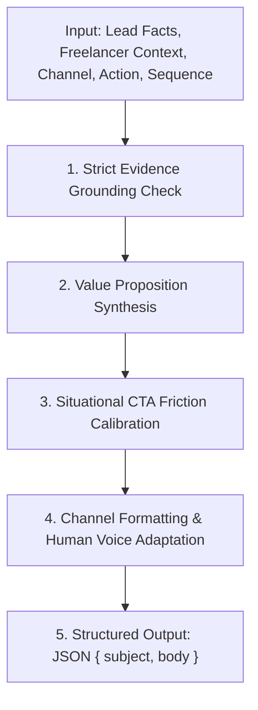

# MAST AI Outreach Intelligence: Research Synthesis & Strategic Principles

## Executive Summary

MAST powers client acquisition for independent freelancers and agencies across multiple channels: Cold Email, Instagram DMs, Phone Scripts, and Website Contact Forms.

To move beyond generic, formulaic AI outreach—characterized by em dashes, corporate buzzwords, hollow compliments, hallucinated audits, and premature meeting demands—this document synthesizes empirical research from Gong's observational datasets, Lavender's sales email benchmarks, HubSpot's personalization research, FTC commercial regulations, and communication psychology.

Crucially, **observational correlation is not universal causation**. Research findings from sales technology vendors provide valuable strategic principles to guide context-aware prompting, not rigid mathematical laws or inflexible writing formulas.

---

## 1. Empirical Research Findings & Data-Informed Principles

### A. Gong Observational Research (85M Outbound Emails & Stage Analysis)
* **Dataset & Methodology Context**:
  * Gong analyzed a dataset of approximately 85 million outbound B2B sales emails sent primarily by corporate sales teams and business development representatives using their conversation intelligence platform.
* **Call-to-Action (CTA) Friction & Interest Gauging**:
  * *Vendor Observation*: Gong observed a strong negative correlation between aggressive meeting asks (e.g., requesting a 15-to-30 minute meeting on initial cold contact) and positive response rates. In their analyzed dataset, interest-based calls-to-action (e.g., asking if a problem is relevant or if the prospect is open to exploring an idea) correlated with more than double the positive reply rate compared to specific time/calendar requests.
  * *Strategic Interpretation*: On cold outreach, asking for a calendar commitment creates high cognitive and scheduling friction. Lower-friction inquiries (gauging interest, asking how a process is currently handled, or asking permission to share an idea) reduce the risk of responding.
  * *Important Qualification*: This correlation does not imply that direct meeting asks never work (for example, in high-intent inbound situations or urgent, high-demand niches), but for cold outbound outreach by independent freelancers, interest-based CTAs generally provide a more natural, low-pressure entry point.
* **Stage-Specific Evolution**:
  * *Initial Touch*: Establish context and relevance; share a single focused observation; ask an exploratory or interest-based question.
  * *Follow-Ups*: Gong's data indicates that repeating the original pitch or relying on generic "just checking in" / "bumping this to the top of your inbox" filler yields rapidly diminishing returns. Effective follow-ups provide a fresh perspective, test timing, or address common hesitations.
  * *Downstream Progression*: Specific meeting proposals or calendar invitations become appropriate once the prospect confirms interest.

### B. Lavender Cold-Email Benchmarks (231,818 Emails Analyzed)
* **Dataset & Methodology Context**:
  * Lavender analyzed 231,818 cold emails to establish predictive scoring heuristics for sales email performance.
* **Reading Grade Level & Cognitive Load**:
  * *Vendor Observation*: In Lavender's dataset, emails scored at a 5th-to-7th grade reading ease level (using standard metrics such as Flesch-Kincaid) correlated with higher response rates (+67% in their sample) compared to messages written at college or graduate reading levels.
  * *Strategic Interpretation*: Busy owners and operators review messages quickly on mobile devices. Complex compound clauses, academic prose, and dense jargon increase reading effort. Plain, direct English facilitates rapid scanning and comprehension.
  * *Important Qualification*: Simplicity is a guideline for scannability, not a rigid restriction that bans legitimate professional or technical terminology when accuracy requires it.
* **Email Length & Visual Scannability**:
  * *Vendor Observation*: Lavender observed that emails between 50 and 100 words generally achieved optimal engagement, with response rates declining as length increased beyond 125 words, and dropping sharply past 200 words.
  * *Strategic Interpretation*: Brevity signals respect for the recipient's time. Short paragraphs (1–2 sentences) format well on mobile screens.
  * *Important Qualification*: Word count should serve as adaptive guidance, not an arbitrary hard cap. Technical or complex services may legitimately require 100–125 words to frame an idea properly, whereas social DMs require 30–60 words.
* **Banned Marketing Buzzwords**:
  * *Observed Effect*: Clichéd marketing phrases (*"elevate your brand"*, *"drive meaningful results"*, *"streamline"*, *"seamless"*, *"synergy"*, *"supercharge"*, *"cutting-edge"*, *"game-changing"*, *"unlock your potential"*) trigger spam filter suspicion and immediately signal generic, automated sales campaigns.
* **Punctuation & Stylistic Patterns (The Em Dash Problem)**:
  * Large language models exhibit an unnatural tendency to overuse em dashes (`—` / `–`) as stylistic hinges (*"I noticed your website — and loved your reviews"*). Real human outreach uses natural conversational punctuation: periods, commas, or paragraph breaks.

### C. HubSpot Research: Substantive Personalization vs. Cosmetic Token Swapping
* Simply inserting a company name, city, or contact first name into a generic template yields no meaningful lift in engagement.
* **Substantive Personalization**: Genuine personalization connects an *observed, verified fact* about the business (such as strong local review reputation, mobile scheduling friction, or specific service offerings) directly to the freelancer's specific craft (e.g., Web Design, Local SEO, Content).
* **Sparse Evidence Grounding**: When available business data is sparse, the model must adopt an honest, exploratory posture (*"I noticed you serve [City] in [Niche]..."*). It must **never** fabricate technical errors, nonexistent broken links, or fake negative reviews to manufacture an angle.

### D. FTC CAN-SPAM Compliance & Commercial Email Standards
* **Deceptive Subject Lines**: Subject lines that simulate ongoing conversations (*"Re: our call yesterday"* or *"Regarding our agreement"*) when no prior relationship exists violate US FTC commercial email regulations and destroy sender credibility.
* **Truthful Identity & Purpose**: Sender identity must be accurate, and the commercial nature of the inquiry must be transparent, providing clear, straightforward opt-out opportunities.

---

## 2. Multi-Channel Distinction Matrix

| Channel | Typical Guidance | Subject Line | Opening Hook | Tone & Posture | CTA Pattern | Forbidden Elements |
| :--- | :--- | :--- | :--- | :--- | :--- | :--- |
| **Cold Email** | 50–125 words, 2–3 short paragraphs | 3–6 words, sentence case, honest & relevant | Specific verified observation or market hook | Concise, respectful peer professional | Low-friction interest ask (*"Open to an idea on this?"*) | Em dashes, corporate jargon, aggressive meeting demands, fake audit claims |
| **Instagram DM** | 30–70 words, single block | None (`null`) | Reference to public profile presence or local niche | Casual, conversational, peer social | Low-pressure conversational reply (*"Mind if I share...?"*) | Email formatting, formal salutations, sales pitch decks, unverified post claims |
| **Phone Script** | 60–100 spoken words (~30–45s) | None (`null`) | Permission/relevance check + concise hook | Spoken dialogue with natural pauses and cadence | Open discovery question + objection pivots | Reading formal prose aloud, high-pressure closes, monologues |
| **Contact Form** | 60–110 words | Concise inquiry topic or null | Direct, courteous business inquiry | Respectful, clear, professional | Request for the appropriate contact person or email | Flattery, claims of completed free work, aggressive pitches |

---

## 3. Dynamic Strategy Selection & Grounding Model

Rather than relying on static lookup tables or canned templates, the outreach generation engine applies a context-aware reasoning chain:

### 1. Strict Evidence Grounding (Non-Negotiable)
- **Every claim must be supported**: Every factual statement must be directly verifiable from the supplied lead data or explicit user notes.
- **Coarse signals do not prove specific defects**: A coarse flag such as `website_is_weak: true` indicates digital opportunity, but does *not* prove a specific load time (e.g. "takes 4.2 seconds"), broken buttons, or technical errors.
- **Average ratings are not unanimous**: A 4.8 average rating across 42 reviews does *not* prove "42 five-star reviews". Reference their strong overall customer reputation.
- **Never claim completed unrequested work**: Never claim to have already prepared a mockup, performed an in-depth audit, or recorded a video teardown unless explicitly provided in context.
- **Zero fabricated proof or history**: Never invent case studies, ROI percentages, client outcomes, guarantees, or prior correspondence.
- **Sparse data directive**: When lead information is thin, adopt an exploratory consultative posture inquiring how they handle that area.

### 2. Value Proposition Synthesis
- Web Designer: focuses on mobile usability, scheduling simplicity, and visual clarity.
- Local SEO Specialist: focuses on neighborhood search discovery and map visibility.
- Social Media Manager: focuses on community engagement and regular visual presence.
- Copywriter: focuses on clear messaging and customer conversion.

### 3. Situational CTA Calibration
- Cold Touch: Interest-based questions (low friction).
- Follow-Up Touch: Offer a specific insight or test timing without generic "checking in" filler.
- Objection Handling: Empathize, validate concern, and offer zero-commitment next steps.

---

## 4. Evaluation Rubric & Methodological Limits

### A. The 9 Evaluation Dimensions
1. **Evidence Grounding**: Zero unsupported metrics, audits, mockups, or review extrapolations.
2. **Relevance to Prospect**: Anchored directly in verified business context.
3. **Relevance to Freelancer Offer**: Authentic alignment with the user's profession.
4. **Value Proposition Credibility**: Realistic, non-hyperbolic benefit.
5. **CTA Appropriateness & Friction**: Low-friction interest asks on cold touches.
6. **Naturalness & Readability**: Clear, conversational English, natural rhythm, zero em dashes, zero buzzwords.
7. **Channel & Stage Fit**: Native formatting for Email, Instagram DM, Phone, and Forms.
8. **Anti-Repetition & Unwanted Patterns**: Fresh angles across touches; no "just checking in" filler.
9. **Contract & Schema Integrity**: Strict adherence to JSON `{ "subject": string | null, "body": string }`.

### B. Practical Limits of Automated Evaluation
* **What Programmatic Evaluation Can Verify**: Deterministic rule adherence, pattern exclusion (em dashes, buzzwords, high-friction meeting asks), schema compliance, and strict factual grounding against input fixtures.
* **What Requires Human Review & Live Testing**: Subtle tone nuances, professional voice authenticity across varied subcultures, and actual inbox deliverability and prospect response rates.
